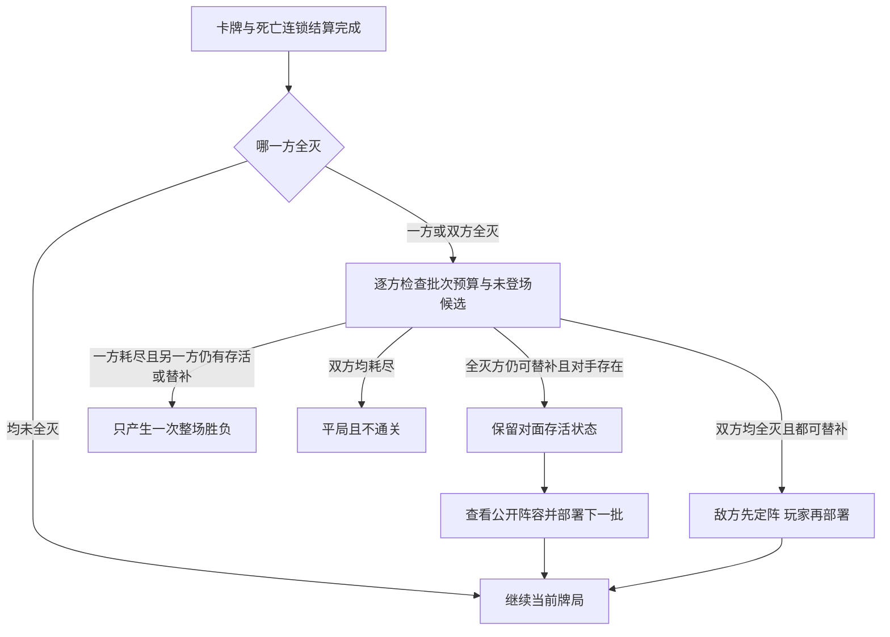
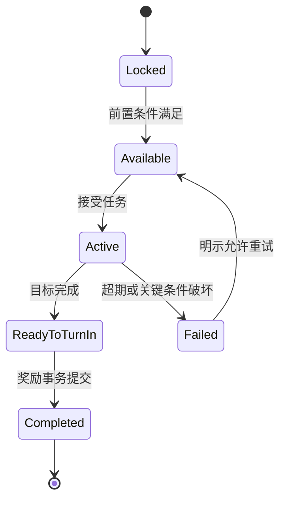

# 三国行纪 制作总纲

日期：2026-11-12　状态：可拆分任务的制作基线

本纲把[游戏蓝图](00-游戏蓝图.md)拆解为系统、内容、界面和制作验收。首要交付是45至90分钟的MVP：从平民开场，完成结交与招募，打赢两阶段攻城，解锁第一座城的后续路线，并签订一种外交协议。完整统一天下属于1.0，不能成为验证前期玩法的前置工作。

## 1 制作原则与优先级

| 优先级 | 必须回答的问题 | 对应交付 |
| --- | --- | --- |
| P0 | 参照战斗能否正确运转，玩家能否理解响应 | 规则可独立测试，交付含OL UI与交互还原的可玩战斗原型 |
| P1 | 玩家是否愿意沿主角的目标与抉择继续玩 | 三背景剧情切片、教学、交集事件、招募、首城MVP |
| P2 | 首城之后能否形成有变化的战略体验 | 多城、完整外交、敌方势力决策 |
| P3 | 三套故事是否各自支撑从无名到统一 | 各线章节、主角转折、人物交集与独立尾声 |
| P4 | 表现和重复操作是否达到发行标准 | 美术、音频、优化、教学与兼容测试 |

每个功能先确定输入、持久状态、失败结果和验收，随后开发。OL桌面、操作部件与状态反馈从P0/M1进入闭环验收；华丽特效和大规模内容填充在闭环成立后推进。规则核心仍可无界面独立验证。

## 2 系统清单

| 编号 | 系统 | MVP范围 | 完整版扩展 | 完成条件 |
| --- | --- | --- | --- | --- |
| SYS-01 | 战斗规则 | OL基础牌组、6名OL武将及其原立绘和完整技能、主角三种I阶、4种通用敌人模板，双方各1至4单位 | 至少100名不同OL武将的完整技能与3条主角进阶路线 | 16种人数配置合法，所有胜负来自卡牌歼灭 |
| SYS-02 | 战斗AI | 合法行动生成、响应、目标估值、救援 | 局部搜索、人物倾向 | 无越权信息访问、无非法操作与死锁 |
| SYS-03 | 地图与时间 | 6地点、旬结算、移动、任务标记 | 6区域24城与章间跳时 | 行动成本和事件时限可预览 |
| SYS-04 | 剧情任务 | 三背景各自开场至首城的切片；每线3主线单元，另共用5支线，合计14个逻辑单元 | 每线15主线单元，另25共享区域支线，共70个逻辑单元；三套完整故事 | 三线各自有目标、冲突、转折、后果与独立尾声，共享内容有各线承接 |
| SYS-05 | 条件招募 | 6名历史人物、3名开放永久招募 | 暂按至少100名OL武将制作永久招募条件；与主角有交集者随事件展开，其余轻量接入；名册不设上限 | 条件满足即允许招募，资格永久保留、奖励不重复 |
| SYS-06 | 出身与技能进阶 | 输出、过牌控场、坦克卖血三种出身及对应I阶；本周目固定其一 | 所选背景完整故事与技能I至III阶，自主招募与后期阵容补位 | 不能跨路线洗职业，三种出身都可通关，首次里程碑不重复发 |
| SYS-07 | 名册与编队 | 无上限永久名册，每方最多4位置、合计最多8 | 双将、编队预设与托管 | 不等员合法，同一武将不重复占位，无人数差补偿 |
| SYS-08 | 领地与路线 | 1城、卡牌胜利占领、首次解锁 | 24城、道路、人物与技能修习战解锁 | 没有牌局胜利记录不能改归属，夺回不重复发首次奖励 |
| SYS-09 | 攻城与守城 | 两阶段守将战、阶段记录、自由换人和重试 | 多种1至4单位阵容与后期双将关卡 | 只有全部必要牌局获胜才占城；守城失败才失城 |
| SYS-10 | 外交 | 互不侵犯、交换线索 | 开放通行、结盟、共同邀战 | 只开放路线和遭遇，不能凭条约占城或代替卡牌判胜 |
| SYS-11 | 存档 | 多槽、自动档、战斗检查点、迁移框架 | 已发布格式样本长期回归 | 中断不会覆盖最后一个有效档 |
| SYS-12 | 图鉴与日志 | 人物线索、任务日志、战斗因果记录 | 纪事与结局回顾 | 玩家能追溯招募条件与战斗结果 |
| SYS-13 | 后期双将 | MVP不启用 | 主线约1/2处的双将协同剧情完成后永久解锁 | 共用单位状态、技能归属清晰，单将仍可通关 |
| SYS-14 | 后期车轮战 | MVP不启用，领域结构预留 | 主线约3/4处的车轮接战剧情完成后永久解锁，每方最多三批 | 批次独立、存活状态延续、不复用已登场人物，最终只结算一次 |
| SYS-15 | 战斗UI还原 | P0/M1按冻结OL PC快照还原桌面、武将框、手牌技能与出牌响应 | 随规则包补齐装备、判定、双将及车轮UI | 截图与逐步操作比对、队伍适配、U系列验收通过 |
| SYS-16 | 台词与配音 | 规则提示、台词字幕与音量分组；短语音可小样验证 | 优先技能与阵亡短语音，主角关键片段可选 | 缺音频回退文字，静音、跳播与读档不改变规则 |

## 3 三套状态必须分开

- **战斗状态：** 体力、手牌、牌堆、装备区、判定区、当前回合、技能次数、待响应请求。整场独立牌局结束后销毁；车轮换批时继续保留。
- **冒险状态：** 主角技能阶位、关系、经历、永久招募名册、编队、任务、首次通关记录、当前地点。持续到整个战役结束。
- **战略状态：** 城池归属、领地解锁、外交协议、时间与待处理守城遭遇。每旬提交后结算。

战斗结束产出一次结果事务，由战役层更新任务、永久招募条件、领地阶段和主角修习资格；不计算军队或经济损失，不删除已招募武将或暂时禁用其出战资格。不能通过直接把战斗体力写入人物永久体力来实现养成。存档包含三套状态的必要快照和连接标识。

## 4 战斗制作规范

### 4.1 规则包与战役包

`rules.sgs-online.v1`存放《三国杀Online》规则快照、牌与结算裁定；`content/manifests/sgsol-generals.json`登记每位OL武将的具体版本、原立绘和完整技能；`rules.protagonist.v1`存放原创主角技能；`campaign.base.v1`定义公开阵营、1至4对1至4人数校验、卡牌歼灭胜负与领地结果。双将由`rules.dual-general.v1`定义单位、体力与技能组合，车轮由`rules.relay.v1`定义最多三批接替和终局判定；各包分别版本化。

P0先实现杀、闪、桃、决斗、过河拆桥、顺手牵羊、无中生有、无懈可击，共8种效果。P0仅使用自定义测试牌堆，不能标为完整OL基础牌组。MVP补完选定OL基础牌组中的其余锦囊、装备、判定及所需技能，并冻结物理牌的花色、点数、数量清单。

武将不以“一个技能一个回调”估工。转换牌、改目标、改距离、替代伤害、判定与濒死干预各有额外复杂度；纳入当前里程碑的角色必须先完成技能复杂度评审。

OL武将接入采用完整技能集：姓名、基础属性、立绘及技能逐项与所选OL版本核对。原文中的主公技、势力、限定技、觉醒技、准备与结束时机等条件按原定义保存，不能为关卡平衡自行增删、改次数、改数值或拼接不同版本。依赖的卡牌或规则机制进入能力清单，全部支持后才进入可战斗内容包；难度通过阵容、人数、座次和模式配置控制。

乡勇、杂兵等通用单位使用通用立绘或头像、基础体力和基础卡牌行动模板，默认不带专属武将技能。具名武将敌人无论是否可招募都遵守OL来源约束，不能将其改名为“杂兵模板”后另写技能。

### 4.2 战斗可操作性

P0/M1必须还原OL对局UI与交互，范围、参照包、队伍控制适配及U-001至U-008详见[界面还原规范](05-战斗界面与交互还原规范.md)。选牌、选目标、技能成本、响应和取消的真实操作流程与规则核心共同验收，不以调试按钮代替。

选牌后先显示合法目标，再确认使用；无效目标说明原因，如“距离不足”或“此目标不符合牌的条件”。技能、卡牌和响应使用同一套请求界面，每次只向当前有操作权的控制者收集输入。

响应默认无倒计时，支持查看当前效果、原始来源和处理顺序。连续无懈等链式响应显示层级，不用若干互相覆盖的弹窗。玩家可在确认前取消，确认后仅能通过读档回到检查点，不能撤销已看到随机信息的行为。

允许查看友方手牌源于玩家控制该队伍的战役模式；敌方团队可同样共享其控制范围内的手牌。查看敌方真实手牌、牌堆顺序或未公开判定必须由规则授权。战斗AI与其控制方使用同一观察权限。

### 4.3 人数、胜负与关卡差异

双方各1至4个场上单位，合计2至8个，不要求人数相等；全部16种人数配置均支持。第5个存活单位、零人首发和总数超8均拒绝开始。换批时一方暂时无人是合法部署状态，不能被误当作零人首发错误；部署完成后仍最多4个单位。剧情援助与双将都遵守同一容量。

普通牌局为每方一批；后期车轮战每方最多三批。完成当前卡牌、濒死、死亡与强制连锁后，一方全灭先检查批次与可用候选：有下一批则进入部署，没有才失败；双方都耗尽则平局、不通关。只击败一批不产生通关、占城或进阶奖励。主动认输只记放弃，无正常胜方；技术异常只保存诊断，不借超时或步数保护判胜。

所有战斗仍只由卡牌歼灭和合法替补耗尽决定结果，不设护送存活、回合数、占点、经济或战力达标胜利。人数差不附加体力、摸牌或回合。关卡变化来自人数、武将、座次、先手、主角固定路线与阶位、单双将及车轮候选池；每场开战前明示模式、最大批次和当前敌方阵容。

普通牌局不能临时加车轮批次，车轮战也不能超三批；两者都调用同一结算策略，区别只在合法替补配置。卡牌原有摸牌、装备、坐骑、判定和技能继续使用冻结规则，不套用身份模式特权。

### 4.4 后期双将初版规则

该模式使用本项目双将组合规则和已登记的OL武将技能；主副人物各自保留所选OL版本，不因配对自动切成另一套国战技能。

| 项目 | 初版决定 |
| --- | --- |
| 解锁 | 主线约1/2处的双将协同剧情完成；永久标记`dual_general`，无招募数量、持城数或固定章节编号检查 |
| 上场数量 | 仍按战斗单位位置计数，常规最多4个，每方最多4单位、双方最多8单位；每位置一主一副，可继续使用单将，每方最多配置8名不同人物 |
| 选择 | 从永久名册任意搭配，不限原历史势力，主角可主可副，无配对好感门槛 |
| 单位状态 | 主副共用一个实体、座次、控制者、阵营、体力池、手牌、装备区、判定区与回合 |
| 体力上限 | 首轮项目公式为两将单将基础上限的平均值向下取整；4与3组合为3，4与4为4；不附带半体力奖励 |
| 技能 | 合并两人完整登记的技能，保留来源武将与原触发条件；主角使用本场固定技能配置 |
| 同名技能 | 相同规则ID只获得一次；次数限制按战斗单位与技能规则ID计数，不能靠两个来源翻倍 |
| 技能目标 | “你”“其他角色”“友方”以战斗单位判断；主副不算两个角色，奋击与坚忍以共享单位体力和伤害判定，筹策不能对同单位副将当作敌方施放 |
| 角色属性 | 性别等单值属性取主将，战斗阵营取战役队伍；历史势力不用于限制配对。与技能冲突时写入双将裁定表 |
| 身份相关技能 | 保存OL原技能及条件；公开阵营模式没有主公身份时，主公技条件不成立；主将位置本身不赋予主公身份 |
| 主副顺序 | 战前可交换，属性预览随之更新；入场后固定，不做战斗中换将、拆将或单独复活副将 |
| 阵亡 | 整个单位按共同体力进入濒死与死亡，两名武将都保留永久招募资格，同场车轮战两名来源人物均已用，整场结束后可重新编队 |
| 模式公平 | 选择双将关卡配置时敌方也按相同双将规则组队，不靠隐藏增伤补难度；单将有对应可通关配置 |

体力公式与跨势力自由组合是本项目变体，不声称与任一国战版次完全一致。所有技能冲突在双将包内裁定；不因组合强而悄悄改动单将技能，也不先加禁配名单限制自由搭配。优先修复规则错误和循环，平衡改动须明示并记录版本。

名册人数增加时使用搜索、标签筛选、排序和编队预设管理，不新增人数容量；双将选择器在已选人物上标记位置，阻止同一人同时占据主副位或两个单位。1.0使用实际可招募内容验证保存、检索和编队，并用200名合成角色补充超量压力验证；MVP可先用合成数据覆盖超过12、30、100人的名册。这些容量测试与1.0至少100名不同OL武将的实际交付分别验收。

### 4.5 后期车轮战规则

车轮战在主线约3/4处的车轮接战剧情完成后开放，使用永久标记`relay_battle`；无招募数量和后备人数门槛。它是同一牌局内的阵容接替，不是三场重新开始的战斗。每方独立计第1至第3批，首发计入上限。关卡可以配置一批普通战或二至三批车轮战；进入牌局后不增加批次预算。批次与普通座次整轮分开命名，避免“每轮限一次”技能随替补错误刷新。没有强制全员存量门槛，名册少也可少上或少用批次，但可能更早耗尽合法候选。

| 项目 | 确定语义 |
| --- | --- |
| 接替条件 | 本方全部场上单位已完成死亡清理，当前用牌与强制连锁结算完，仍有批次预算和至少1名合法未登场候选 |
| 不满编与局部死亡 | 可少于4人；一人或几人死亡不能补位，尚存一个单位也不能主动全换 |
| 玩家选择 | 展示对面存活武将及主副、体力、手牌数、装备、判定、标记等公开信息，玩家再选本方下一批1至4单位及位置 |
| 隐藏信息 | 不展示敌方暗牌、未来牌序和未公开后备选择；换阵不能借预览消耗或试探随机数 |
| 候选来源 | 从开战冻结的永久名册与本场明确授权援助中取本场未登场者；不预锁第二、三批，不能战中招募扩充池 |
| 人物使用 | 人物首次实际登场即记已用，同一牌局不能再次登场；主角同样，双将两名来源都计已用，不能拆出来复用 |
| 对手存活状态 | 体力、手牌、装备、判定区、标记、技能次数、控制者与实体ID全部保留 |
| 新批初始化 | 满体力、空装备与判定区，按模式起始手牌数从同一牌堆发牌，建立本批实体与技能计数；首次模式参数在M3冻结 |
| 牌堆与随机 | 同一牌堆、弃牌堆与RNG延续，不因换批重新洗牌；只在正常摸牌空堆条件下按参照规则洗回 |
| 回合与座次 | 新批复用本方逻辑座次位置，空位跳过；保留行动游标，当前角色若存活继续其剩余回合，已死亡则按游标进入下一有效角色，不额外赠送一轮 |
| 旧效果 | 新批在旧用牌与连锁结束后才入场，不追溯成为旧AOE目标；存活者尚未执行的判定与延时效果仍保留 |
| 开局触发 | `BattleStarted`整场仅一次，换批是`FormationEntered`；游戏开始技能不因换批重触发，候选预览说明其适用范围 |
| 单边全灭 | 仅全灭方换阵，对方不重配；已用完三批或没有合法候选者失败，不强迫做空阵容部署 |
| 双边同时全灭 | 都可替补时，敌方先按既定候选规则确定并公开下一批，玩家再选；只有一方可替补则该方获胜，双方均无则平局 |
| AI换阵 | 只依据己方可用池、对面当前公开场面与既定权重；不能读取玩家未提交的下一批，已确认后不得反向重选 |
| 双将组合 | 本场单双将模式不变；双将模式中可重新组合尚未登场的来源人物，每方仍最多4单位，不能回收已阵亡副将 |
| 胜负与奖励 | 只有合法替补耗尽后才产生整场结果；中间换批无占城、经验、招募或首次通关奖励 |
| 存档与退出 | 换阵请求、候选、已用集合、双方批次和对手存活快照可保存；退出不恢复已用人物，整场结束或重新挑战才重置 |

单将车轮战每方至多12名人物，全双将至多24名；这是“3批乘4位置”的最多使用量，不是名册上限，也不是必须填满的要求。名册只有19名可用人物时仍可用混合或少人批次，不能凭空复制补足24名。



## 5 冒险与任务制作规范

### 5.0 以主角事件组织内容

先完成三条主角故事大纲，逐章确定主角要什么、为何受阻、做什么选择、承担什么代价以及如何进入下一阶段，再为需要的事件安排武将。制作与验收按“背景故事—章节—事件”拆分，不按固定重点武将各立一条任务链。

每次人物交集注明其对主角目标的作用：共同困境、立场冲突、选择见证或后果反馈。同一武将可在不同路线以不同身份和深度参与，事件完成不必等同于招募。与当前故事没有深交者配置轻量出场与招募；人物是否已加入、是否出战由有限状态变体承接，不让可选招募成为主线必需条件。

三线共用人物技能、地图、战斗模板与操作教学；共享任务需分别说明主角为何参与及结果如何承接。背景差异必须延续至中后期和尾声，不能只改开场。制作计数按独立主线单元、共享区域支线和轻量事件分列，重复引用不增加独立故事数量。

### 5.1 任务状态机



任务状态名是数据字段，界面显示中文。失败后若不重试，必须进入可继续的替代分支；核心主线不能因可错过支线永久卡住。

任务定义至少包含：稳定ID、storyRouteId（或共享适用范围）、所属章节、主角当前目标、冲突、关键选择、后果与下一事件、参与人物及作用、出现条件、开始地点、步骤、选项条件、耗时、战斗引用、成功结果、失败结果、一次性奖励ID、是否可重复。条件和效果必须来自受控列表，不在文本内任意执行脚本。

### 5.2 招募判断样例

```text
允许招募某武将 =
    该武将尚未被招募
    且 当前故事下至少一条明示的招募路径全部条件满足

玩家确认招募后 =
    永久写入 recruitedCharacterIds
    并记录招募来源、时间与已完成的条件ID
```

界面列出实际缺项，例如“尚未完成求援任务”“尚未赢得该武将挑战”“尚未首次占领指定城池”。条件全部满足则显示可招募；没有营地容量、阵营冲突、忠诚度或随机拒绝的额外检查。已招募状态只读，后续剧情、关系下降与战败均不能清除。招募前剧情援助与永久招募分开记录，不建立限时招募类型。

多条替代路径之间为“或”，单条路径内条件为“且”；界面按路径分别列出缺项，不能要求同时完成不同背景专属条件。深度交集中的招募机会被跳过时，保留本线明确可达的轻量替代路径。

人物列表与招募入口由所选故事、地点、剧情、通用任务和玩家操作决定。出身决定故事和技能，可以改变与人物相遇的情境及条件路径；人物列表不按职业生成排序权重或搭档提示。三线共用武将池，各线为可招募人物保留通用或替代路径，不要求同一人物在三线都深度参与。MVP中的关羽、赵云、华佗可复用同一战斗模板，但由各线事件解释接触原因；实际开放时点和条件按本线展示，玩家自由选择招募及编队。

双将协同与车轮接战在三条主角故事中各自设计事件，分别安排在本线叙事约50%和75%的里程碑。各线对应任务完成后分别提交`story.dual_formation.completed`和`story.relay_battle.completed`（携带storyRouteId与具体事件ID），原子写入永久功能标记；解锁条件只有对应剧情完成，剧情前置也不使用招募人数、后备人数或指定武将持有条件。

功能已解锁与阵容当前可用分开呈现：组成一对双将需要当前有两名合法且不同的人物；车轮接替需要尚未登场的合法候选。这些是具体编队与接替的合法性要求，不影响功能解锁状态。剧情重复触发、失城和人物本场已用不清除永久标记；两项功能各读取自己的剧情标记。

### 5.3 内容实例记录

同一剧情奖励由`campaignId + questId + rewardId`唯一标识。战斗、对话与过旬不直接发第二份奖励；最终统一由应用事务提交。接受、完成、失败、永久招募和条约兑现均需存档重载案例。

## 6 领地与主角成长规则

### 6.1 城池状态与占领条件

每城只记录稳定ID、所属区域、道路邻接、当前归属、守将遭遇列表、当前挑战阶段、已解锁内容与首次占领标记。城池数据由归属、路线、守将挑战和内容解锁组成。

攻城前置只有：路线和剧情已开放，目标对应的卡牌挑战可用，玩家选好1至4个单位。已有领地不是首城的前置，不设置出征成本或军队门槛。场前列出每个守将阵容和需通过的阶段；普通城可只有一场，MVP首城配置外围战与城内战两场。

| 卡牌结果 | 领地变化 | 进度与下一步 |
| --- | --- | --- |
| 外围战胜利 | 暂不改变城主 | 写入阶段通过，开放城内守将；可自由换人 |
| 最后必要阶段胜利 | 目标城归玩家 | 原子提交归属、首次占领、路线、人物与技能修习战解锁 |
| 任一阶段失败或平局 | 不改归属 | 保留本次已通过阶段，可在未通过阶段立即重试 |
| 玩家守城胜利 | 继续归玩家 | 清除该守城遭遇 |
| 玩家守城失败 | 挑战方取得该城 | 永久名册、已学技能和首次通关记录保留，之后可卡牌夺回 |
| 守城平局或稍后处理 | 暂不改变归属 | 保留待处理遭遇，完成前不继续世界推进 |

所有归属变更必须引用一个已完成且模式合法的最终卡牌胜利结果：攻城用玩家胜利，失城用敌方胜利。对话、劝降、联盟、势力吞并、后台战力比较和自动扫荡均不能转移城池。首城与后续城使用同一套机制，不另建教学军粮账户。

独立攻城阶段是不同牌局，重新发牌、洗牌、恢复标准体力，只继承挑战阶段；同一车轮战的接替批次保留对方存活状态和同一牌堆，不适用独立阶段重置。玩家每场可自由从名册选人，不锁定整次攻城的阵容。再次重玩或夺回同一城不重复领首次奖励。

MVP复用6个基础遭遇定义，各线分别配置开战理由、前后剧情、人物交集与条件路径，教学展示所属技能；这些战斗模板不代表三线共用同一条剧情。每场我方都可选1至4单位；表中敌方人数为首轮候选配置，可在平衡后调整，但不得超4。

| 遭遇 | 敌方人数 | 用途与首次结果 |
| --- | --- | --- |
| 村口教学 | 2 | 主角与可选乡勇援助，理解杀闪桃与当前出身I阶技能 |
| 驿路冲突 | 2 | 关羽招募条件与后续路线 |
| 赵云挑战 | 3 | 赵云永久招募条件 |
| 华佗修习 | 3 | 同一场首次胜利同时推进华佗招募与当前出身入门修习记录 |
| 首城外围 | 2 | 攻城第一阶段，可在此验证4对2 |
| 首城决战 | 4 | 最后守将战，可验证4对4或玩家自选1对4；胜利取得首城 |

华佗修习共用一个战斗结果ID，招募任务和技能修习分别登记对应一次性解锁，不发两次“战斗胜利”事件。教学援助也计入我方4个位置；已招募3名历史武将加主角即可在MVP组出4个单位。

### 6.2 出身固定路线与技能进阶

开局选择`damage`（乡勇、伤害输出）、`control`（寒门学子、过牌控场）、`tank`（山野农户、坦克卖血）之一。路线在本周目不可变，主角仅装配所属路线的一份核心技能；同一路线可在战前选用已解锁阶位，不能跨路线学习或在车轮部署中换职业。三种出身起始体力上限均为4，主角可不上场，出身差异通过队伍配合弥补。

| 阶位 | 首轮解锁条件 | 成长含义 |
| --- | --- | --- |
| I阶 | 创建角色时确定路线，教学启用所属核心技能 | 建立输出、控场或承伤卖血定位 |
| II阶 | 首次占领3座不同城池，并赢得所属路线II阶修习战 | 强化该路线的核心作用 |
| III阶 | 第四章已开放、首次占领8座不同城池，并赢得所属路线III阶修习战 | 增加该路线的持续作战或决策空间 |

MVP包含三种出身、三种I阶技能和同一入门修习遭遇的三套教学反馈；II、III阶在完整版加入。修习只能提升当前路线，不能将另一出身的技能作为奖励。招募入口随各线故事开放，OL技能资料与中立排序规则共用，条件路径可以不同；阵容选择由玩家决定。

| 核心技能 | I阶 | II阶 | III阶 |
| --- | --- | --- | --- |
| 输出 奋击 | 出牌阶段限一次，使用杀且最终仅一个目标时，可额外弃1手牌；该杀对该目标首次伤害加1 | 若支付时目标体力大于你，可免去额外弃牌，其余沿用I阶 | 沿用II阶；每你的回合限一次，奋击造成伤害结算后若你仍存活，摸1牌 |
| 控场 筹策 | 出牌阶段限一次，弃1手牌；令一名有手牌敌方自行弃1手牌，然后你摸1 | 你改为摸2牌，其他沿用I阶 | 敌方可弃区域扩为手牌或装备区，由其自行选；有任一区域牌即可成为目标，其他沿用II阶 |
| 卖血 坚忍 | 每回合限一次，受到伤害及其濒死流程完成后仍存活，可摸1牌 | 改为摸2牌，触发条件不变 | 沿用II阶；你的结束阶段开始时，若已受伤，可弃2手牌回复1体力，每个结束阶段限一次 |

奋击伤害加成为明确原创技能，不是永久提高基础杀伤害；仍可被闪和相应规则阻止，被闪不退费用，也不多一次杀。筹策不揭示暗牌，不跳过支付和目标弃牌选择；筹策III阶也不影响判定区。坚忍不因失去体力触发，不免伤、不免死、不先于濒死救援给牌，满体力不能为自疗效果无故弃牌。

“每回合”按一个角色完整回合计，“出牌阶段”按阶段计；车轮批次不是上述次数范围，换批不重置存活武将的计数。技能I至III阶每次仅装一份，不把三个阶位叠加。主角所属路线与本场阶位开战锁定，换批只调整出场人物、位置与已允许的双将配对。

### 6.3 永久成长账本

以`campaignId + milestoneId`记录首次战斗胜利、首次招募、首次占城、修习通过与技能解锁。战果提交同时更新对应标记，重复消息、重载、夺回和反复挑战不得重复产生资格。

累计首次占城数从已记录的不同城池ID集合计算，不使用当前持城数；领地丢失不抹掉历史进阶。统一判定仍要求当前控制全部目标城池并赢得终局战，不因历史上曾经全占就跳过牌局。

### 6.4 外交与敌方挑战

MVP保留互不侵犯与交换线索。互不侵犯为6旬，在第T旬签订后适用`[T, T+6)`，只暂停生成新的敌对遭遇；交换线索一次性开放人物位置或可选挑战。不设现金费用、资源收益或逐旬利息，同一双方同一类型协议不叠加。

完整版补开放通行、结盟与共同邀战，均以路线和遭遇解锁实现。援助人物如参战计入我方4位置，不能获得第五个单位。条约不能清除已经开始的牌局或已生成的守城挑战，不能赠城或直接判胜。

敌方战略AI根据邻接图、条约、可挑战城池与剧情条件生成守城挑战，不使用经济或战力模拟。全部敌对势力合计每旬最多1次针对玩家的领地挑战；玩家完成真实卡牌防御战后才应用结果。首版不模拟NPC之间的后台吞并，叙事章节转换也不能无卡牌记录地改变已开放目标城池归属。

## 7 世界推进的固定顺序

1. 检查没有活动牌局或未处理守城遭遇，锁定本次`turnResolutionId`。
2. 处理移动、拜访、剧情和线索开放等排期事件。
3. 更新外交期限，按固定顺序评估敌方可生成的卡牌挑战。
4. 若有守城遭遇则挂起推进，保存游标；真实牌局结束后应用领地结果并恢复。
5. 检查首次占领、招募、主角技能修习与章节解锁，使用成长账本去重。
6. 旬编号加一，刷新2个探索行动，生成事件简报并写自动档。

没有资源产出、军队维护和经济损耗步骤。卡牌挑战不扣探索行动；战败可立即重试，不能靠空耗回合自动获胜。已生成守城战未解决时，离开面板不改城主、不记作输赢，只暂停世界推进。

## 8 视听与界面方向

### 8.1 美术方向

采用**水墨山河、绢纸文书、清晰卡牌**。人物以半写实立绘呈现，地图用手绘轮廓和有限动态，界面参考军报、竹简的构图语言，但文字底板保持平整。主角与通用角色使用本项目形象，出场武将使用登记的OL原画或原皮肤素材；地图、人物名册与剧情页面使用本项目设计；战斗桌面及操作部件按冻结OL PC界面还原，不套用独立原创战斗布局。

OL武将原画在独立的人物展示框内适配，不增加自绘表情或替换服饰。界面以密集决策的可读性为先，纹理只放在边框和留白区。地图与对话使用下表文书主题；战斗页的构图、武将框、手牌、按钮与操作状态以OL快照为先，战役新增标记及扩展说明保持文字可读性和状态语义一致。

| 语义 | 色值或规范 | 用途 |
| --- | --- | --- |
| 主背景 | `#171B1A` | 战役侧栏底色；战斗桌面以OL快照为准 |
| 文书表面 | `#EDE3CF` | 对话、任务、规则说明 |
| 深色正文 | `#252B29` | 文书上的长文字 |
| 浅色正文 | `#F3EDDF` | 深背景上的正文 |
| 次要文字 | `#B8B7A8` | 辅助信息，须实际测量对比度 |
| 决策强调 | `#C3A66A` | 当前操作、选中描边，文字用深色 |
| 风险色 | `#A8463A` | 配合风险图标及文字，不单独编码敌我 |
| 我方与敌方 | 阵营徽记、名字、边框形状加颜色 | 色觉差异下仍可辨认 |
| 字体 | 标题宋体风格、正文黑体风格；均选可随游戏分发字体 | 具体字体及许可在素材清单登记 |

上表为战役界面视觉草案，不能作为替换OL战斗配色的依据；尚未进行真实界面测量。实现时正常正文对比度目标至少4.5:1。字体打包到本地，不依赖在线加载；不能把只覆盖拉丁字符的字体用于中文正文。

### 8.2 五个主页面与换阵面板

| 页面 | 主信息 | 主要动作 | 次级信息 |
| --- | --- | --- | --- |
| 天下地图 | 地点、归属、道路、时间与行动点 | 选择去向或结束本旬 | 名士线索、风险、地图筛选 |
| 剧情事件 | 人物立绘、正文、已知代价 | 选择对话或行动 | 历史纪事、关系变化回顾 |
| 卡牌战斗 | 当前阶段、角色体力、手牌、待响应效果 | 使用、响应、结束阶段 | 因果日志、技能和距离说明 |
| 营地人物 | 永久名册、阵容、主角技能阶位 | 编队、修习、拜访 | 任务条件、经历、图鉴 |
| 领地外交 | 城池归属、守将阵容、解锁路线、条约 | 挑战城池或提出协议 | 首次占领记录、人物与修习线索 |

创建角色时并列展示三种出身的定位、I阶技能与成长预览，确认后说明本周目路线固定。车轮换阵使用牌局内面板：对面当前公开状态保持可见，本方候选过滤已用人物，显示双方第几批、剩余批次、位置与双将配对；不能以仍有名册人物为由暗示已用者可再次上场。

战斗桌面采用OL参照的主操作区及周边座次布局，具体锚点由M0快照冻结，不再采用固定上下各四人的独立桌面。底部展开当前有操作权友军的手牌和技能，其余单位按参照视角映射，规则座次与距离不变；单位的体力、手牌数和状态保持可见。中央处理区、按钮、提示和日志按参照布局实现，单机扩展信息另层展示。双将共用一个单位框，车轮换阵沿用公开状态面板，后两项在M3后扩展。

### 8.3 可用性规范

- 基准1920×1080，最低验证1280×720；支持窗口缩放与125%、150%、200%系统缩放。
- 1080p正文起点20逻辑像素，长规则可展开；字号放大时重排侧栏，不能仅放大导致按钮被裁切。
- 卡牌选择、目标选择、确认、取消均有按钮和键盘路径，不强制拖拽。
- 焦点可见；危险操作明确说明代价；关闭说明面板不会自动放弃响应。
- 动画提供1倍、2倍、4倍与减少动态；动画取消不改变规则结果，跳过后仍可读日志。
- 选择反馈目标100毫秒内；卡牌移动150至250毫秒；长台词和过场可跳过并留在日志。
- 空态说明下一步，例如“尚无可邀约人物，前往驿站寻找线索”；错误给出恢复动作。

### 8.4 音频范围

MVP配置4首可循环音乐：探索、普通战、攻城、营地；约20个交互与战斗音效。原型先实现规则文字提示与已配置台词字幕，角色技能、阵亡短语音采用A1分阶段接入；M1可试接1名测试武将，MVP优先已登记且易集成的片段，不要求全人物覆盖。完整版目标10首音乐和约50个音效，角色语音片段单独统计；主角关键片段可选，长剧情全配音不作为承诺。音效区分选中、无效、伤害、回复与技能触发，避免只靠视觉理解战况。BGM、效果音和角色语音分别调节；缺失短语音回退字幕，连续触发限并发或排队，跳过动画与读档不改变规则、不重复旧语音。分层范围及验收以[界面还原规范](05-战斗界面与交互还原规范.md)第5节为准。

## 9 内容与资产生产

| 资产类别 | MVP累计量 | 1.0累计目标 | 控制成本的方法 |
| --- | --- | --- | --- |
| OL武将立绘资源 | 6位各绑定1套OL原画或对应皮肤 | 至少100名不同人物各绑定1套OL资源 | 登记原画和皮肤ID、整理与核验来源，不制作替代武将立绘 |
| 主角与通用角色立绘 | 主角3种出身形象、乡勇杂兵头像 | 主角及约12套通用形象或头像 | 通用形象复用，人物类别明确，不冒充OL武将 |
| OL战斗UI参照及部件 | M0冻结1套PC端参照，M1完成桌面与核心操作状态 | 沿用同一套，随能力矩阵扩展 | 截图与操作录像对应，登记来源与项目差异，不混搭其他产品 |
| 台词字幕与角色短语音 | 提示与字幕先行，短语音按难度小批接入 | 以实际片段清单统计，不承诺百人全配音 | 逐事件绑定，字幕回退，短语音优先于长剧情录制 |
| 场景背景 | 4张 | 12张 | 同区域复用，天气用叠层 |
| 区域地图 | 1张 | 6张 | 统一标记和道路组件 |
| 地图城池图标 | 4种 | 8种 | 级别与阵营组合复用 |
| 卡面表现 | 一套通用框架与效果图标 | 同一套，按牌类补插图 | 不按每张物理牌重复绘制 |
| 剧情文本 | 三背景首城切片分别估字数，共用文本去重 | 按三线章节与事件表重估，不沿用单主线10万至15万字预算 | 共用环境描述，主角目标、选择后果与尾声分别创作审校 |
| 主角故事 | 三种背景各自从开场到首城的切片 | 三套从无名小辈到统一天下的完整故事 | 共用世界与玩法资产，各线保持独立因果链及收束 |
| 武将交集与轻量事件 | 由各线切片事件推导 | 按路线与事件确定参与深度，不设重点人数配额；覆盖至少100名武将入口 | 有交集随主角事件展开，无深交采用轻量招募模板 |

OL武将资产还需登记`generalId`、`variantId`、`sourceSnapshotId`、`portraitId`、`skinId`及文件摘要；皮肤只决定立绘，不替换该武将版本的技能集。所有资产登记ID、用途、尺寸、作者、来源、许可及适用分发范围。占位图和参考图单独标记，公开包构建检查禁止混入未批准占位资产。素材生产以实际游戏展示尺寸检查，不只看原图。

## 10 交付完成定义

系统开发完成同时要求：可操作、可保存和恢复、边界错误有提示、关键路径有验证、设计文档同步。只在调试面板生效不能算完成。P0/M1另要求OL式战斗UI与交互还原验收，通过可操作客户端和冻结参照的截图、录像对照提供证据。

内容完成要求：数据校验通过、任务路径走通、奖励无重复、人物立场一致、文本无占位、资源路径有效。每段重要剧情至少校验成功、拒绝、失败三条路径。轻量人物事件逐人验证出现条件、首次接触、招募缺项或仅出场说明、加入结果、重复访问和中断恢复；共用模板不能替代逐人入口与引用验证。

1.0发布条件另含：至少100名不同OL武将的版本、立绘、完整技能、依赖机制、AI合法操作和实际出场入口全部完成；三条主角故事各自从开场到统一尾声可达，人物交集与轻量入口按本线验证。人数按人物身份去重，不能用图鉴占位、同人异版或皮肤补足。剧情层级不参与武将战斗能力裁剪。

MVP发布条件：每线3个独立主线单元加5个共享支线池，共14个逻辑单元、6个基础遭遇配置、6名历史人物及每线3个永久招募结果到位；三种背景均能从各自新档连续玩到首城结尾，至少两种编队可通关，支持任意玩家决策点中断后恢复；验收永久招募和名册超过12人后的自由换人。此处“决策点”指引擎已停稳等待输入的位置，具体安全保存机制见架构文档。

## 11 范围与验收优先级

规则正确性、永久名册、存档安全、OL武将立绘与技能来源一致性、每方4单位、车轮三批上限、当前出身路线及1.0三套完整主角故事、至少100名不同OL武将是交付约束。迭代任务按可验证体验、依赖与工时排序，超出100名的扩充、支线深度、地图规模和通用资源表现按产能配置。

原型延期时可后置高级特效与角色短语音，不后置核心OL桌面和操作流程。完整版延期时优先减少轻量人物的对白长度、独立支线分支、立绘表情、专属场景、地图地点和外交动作；保留三套主角故事各自的因果链、关键转折、独立尾声及每位武将的有效入口；不以合并三线为同一主线节省工作量。地图可评估缩至16座目标城池、4区域、三类结局可复用终局战斗模板，各线保留独立剧情收束，但必须同步重写蓝图统一条件与人物入口，不能只删数据。1.0武将总量不得低于100名，不删改完整OL技能；若仍超出产能则延长排期。少于100名的阶段包只能标为原型或试玩，不能作为1.0完整版验收。
