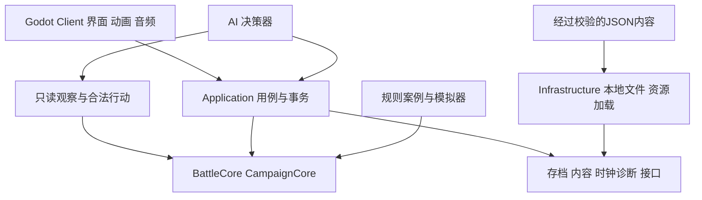
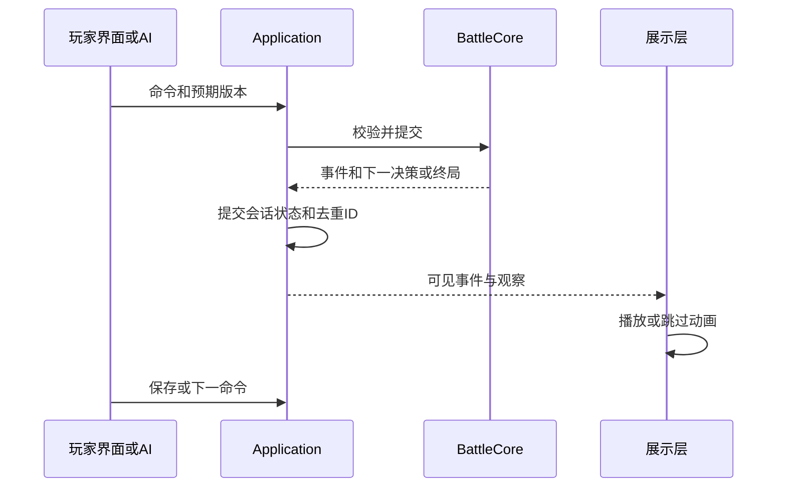

# 三国行纪 技术架构

日期：2026-11-12　状态：设计方案；G0工程与六种牌战斗核心已实现子集，完整关口待验收

架构采用**Godot .NET负责2D表现与交互，纯C#负责战斗、任务和战略，版本化数据驱动内容**。所有玩法共用可检查的命令入口；画面播放、AI选择和存档读取均不直接改写领域状态。最重要的工程目标是：相同版本、初始状态和输入得到相同结果；复杂响应可暂停；战斗与世界奖励只提交一次。主角出身在周目内固定，车轮批次在同一牌局内延续状态，不借重新开局实现。

## 1 技术选型与验证边界

| 层面 | 决定 | 选择依据与限制 |
| --- | --- | --- |
| 引擎 | Godot 4.7.2 .NET作为G0候选基线 | G0验证后锁定编辑器、导出模板与下载校验值 |
| 语言与运行时 | C#、.NET 10 LTS作为候选 | 适合纯逻辑库、类型约束与命令行模拟；与所选Godot版本的构建和导出组合须实测 |
| 渲染 | 2D Canvas、Control节点、Compatibility渲染器 | 低成本卡牌和地图界面；G0测实际目标机，遇不兼容再记录调整 |
| 规则核心 | 独立C#类库 | 不引用Godot、UI、文件系统或网络，可用`dotnet test`运行 |
| 内容 | UTF-8 JSON、Schema、稳定字符串ID | Git可审阅，易校验和迁移；首版避免自建大型编辑器 |
| 存档 | System.Text.Json快照、命令尾日志、SHA-256完整性校验 | 小型单机不引入数据库；校验用于发现损坏，不用于防作弊 |
| AI | C#规则启发式，后续有限深度搜索 | 不调用在线大模型，成本与响应可预测 |
| 测试 | .NET测试项目、xUnit、固定随机种子模拟器 | 具体包版本在G0锁定；不依赖画面才能测规则 |
| 协作 | Git、Git LFS按需管理大体积源素材 | 最小流程可本地完成，CI接入仓库托管后再启用 |
| 发布 | Windows x64离线包优先 | macOS正式分发作为后续单独验证项；不承诺Web导出 |

Godot官方说明，C#项目需要.NET版编辑器及单独安装的SDK，并且Godot 4的C#项目当前不能导出到Web。[C#支持与前置要求](https://docs.godotengine.org/en/stable/tutorials/scripting/c_sharp/c_sharp_basics.html) 引擎候选基线为Godot 4.7.2 .NET；正式工具链以G0实际构建和目标机运行结果锁定。[Godot官方下载](https://godotengine.org/download/windows/)

.NET官方支持表将.NET 10列为LTS，本方案据此选择其作为候选；不因为Godot文档写有较低SDK最低要求，就假设所有SDK和导出组合已被验证。[.NET支持策略](https://dotnet.microsoft.com/en-us/platform/support/policy/dotnet-core)

### 1.1 G0必须完成的技术试验

在当前macOS开发机完成：候选SDK构建纯C#库、Godot加载同一库、调用一个命令并展示结果、JSON保存恢复、生成Windows包；在独立Windows 11 x64设备实际运行该包，确认目标机无需另装开发SDK。结果写入`docs/decisions/0001-toolchain.md`，随后建立`global.json`、依赖锁文件及Godot版本记录。

SDK、Godot客户端目标框架和纯逻辑库目标框架应一致，除非G0记录了有测试依据的兼容分层。若.NET 10组合失败，先选有验证依据且仍受支持的Godot与SDK组合；不能静默退回已结束支持的运行时。找不到合适组合时，以单独架构决策选择Godot GDScript客户端配共享规则方案或其他引擎，并重新估工。

当前工程已建立G0试验子集，工具链仍待独立Windows设备验收。运行结构为本地Godot客户端、纯C#核心和本地内容文件。

### 1.2 为什么不默认选择其他栈

Unity与Unreal适合更重的3D与成熟团队流水线，本项目当前的卡牌、立绘与节点地图不足以抵消额外工程负担。浏览器栈适合快速界面原型，但本项目以离线桌面游戏、资源管理和打包为中心，因此选Godot原生客户端。这里是项目适配判断，不是对各引擎能力或当前商业条款的全面比较。

## 2 模块与依赖



箭头表示调用或依赖方向；基础设施实现接口，核心不反向引用客户端。`Application`负责协调两个领域的事务，但`BattleCore`不依赖`CampaignCore`，二者通过`BattleSetup`与`BattleOutcome`交换数据。

### 2.1 模块职责

| 模块 | 拥有状态 | 允许操作 | 禁止事项 |
| --- | --- | --- | --- |
| BattleCore | 牌、角色、回合、处理区、结算帧、响应、战斗随机流 | 校验战斗命令、执行牌效果、生成观察 | 读UI树、访问磁盘、直接发战役奖励 |
| CampaignCore | 主角技能阶位、永久名册、任务、领地、条约、时间 | 探索、招募、卡牌攻守城、首次成长解锁、世界推进 | 直接变更活动战斗手牌与体力 |
| Application | 会话、用例流程、事务ID、未完成城池挑战 | 开始战斗、提交结果、保存、恢复、错误转换 | 绕开领域规则修改字段 |
| Content | OL规则快照、武将立绘与完整技能绑定、主角与通用角色、任务与地图 | 校验、加载、生成只读内容目录 | 装载任意C#代码或外部可执行脚本 |
| AI | 已观察信息、有限记忆、搜索预算、独立随机流 | 在允许动作中选命令 | 访问敌方手牌、真实牌堆与开发全状态 |
| Client | 当前选择、OL式战斗交互状态、面板、动画与音频队列 | 展示观察、发命令、播放已提交事件 | 决定命中、抽牌、死亡和奖励 |
| Infrastructure | 本地文件与压缩、序列化实现 | 实现存档和资源接口 | 把Node实例序列化为规则状态 |

### 2.2 建议工程目录

以下目录为工程目标，当前已实现子集见[开发进度](06-开发进度.md)，未列为完成的模块仍属规划：

```text
sanguo/
  README.md
  docs/
  src/
    Sanguo.BattleCore/
    Sanguo.CampaignCore/
    Sanguo.Application/
    Sanguo.Content/
    Sanguo.AI/
    Sanguo.Infrastructure/
  client/
    project.godot
    Sanguo.Client.csproj
    scenes/
      battle/  world/  camp/  dialogue/  settlement/
    presentation/
    assets/
  content/
    manifests/  cards/  characters/  skills/
    encounters/  quests/  maps/  diplomacy/  localization/
  tests/
    Sanguo.BattleCore.Tests/
    Sanguo.CampaignCore.Tests/
    Sanguo.Integration.Tests/
    fixtures/  replays/  save-migrations/
  tools/
    Sanguo.ContentValidator/
    Sanguo.Simulator/
  assets-source/
  build/
```

## 3 领域数据模型

当前实现位于`Sanguo.BattleCore.Basic`：`BattleState`、`Combatant`、`BattleAction`、显式`EffectFrame`和按控制者脱敏的`BattleView`。`BasicBattleSession`验证命令版本、请求、控制者、操作单位及幂等记录；`BasicBattleSnapshotCodec`独立保存基础战斗，不修改G0会话或其存档格式。当前支持无技能通用单位、杀闪桃、决斗交替出杀、无中生有及连续反无懈，包含摸牌/出牌/弃牌、救援死亡和单批次终局。`BattleResponse`公开当前响应类型、来源、目标、关联牌和反制层数；`ResponseToCardId`绑定无懈命令的具体反制对象，`CounteredCardId`保留链上引用。基础战斗引擎现为`0.3.0-basic-development`、规则包v2、快照格式2；旧基础战斗开发快照明确拒绝。以下完整模型仍是目标规格。具体边界见[基础战斗开发规则](10-基础战斗开发规则.md)。

### 3.1 战斗

| 对象 | 关键字段 |
| --- | --- |
| BattleState | battleId、rulesetId、rulesetVersion、enabledRulePacks、modeId、stateVersion、turnCursor、phase、turnNumber、activeUnitIds、relayState |
| Combatant | entityId、primaryCharacterId、secondaryCharacterId（可空）、activeSkillInstances、controllerId、teamId、seatId、hp、maxHp、alive、skills、marks |
| CardInstance | instanceId、definitionId、suit、rank、zone、ownerId |
| CardUseContext | useId、sourceId、虚拟牌定义、实体支付牌ID、目标与子目标、响应要求 |
| ResolutionState | 显式Frame栈、延后效果队列、触发排序状态、濒死栈、当前死亡批次 |
| PendingDecision | requestId、controllerId、decisionActorId（可空；非空时为当前操作单位）、允许动作及选择约束、来源、continuationFrameId、stateVersion |
| RandomState | 固定算法版本、各随机流内部状态及消费计数 |
| BattleOutcome | outcomeId、battleId、resultStatus（胜、负、平、放弃）、winner（可空）、endReason、参与单位战况、最终stateHash |

实体卡牌只属于一个区域：摸牌堆、手牌、装备区、判定区、处理区、弃牌堆或规则明示的其他区域。牌效果解析中使用处理区，防止响应未结束牌就进入弃牌堆被错误洗回。虚拟牌是使用上下文，不伪造多一张实体牌。

车轮状态独立于战役永久名册：

| 对象 | 关键字段 |
| --- | --- |
| RelayState | enabled、maxWavesPerSide（1至3）、sideStates、transitionId、transitionPhase、resumeTurnCursor |
| SideRelayState | teamId、currentWave（首发为1）、currentFormationUnitIds、eligiblePoolSnapshot、usedCharacterIds、pendingDeploymentId |
| DeploymentDecision | requestId、teamId、nextWave、allowedCharacterIds、opponentPublicViewVersion、规则模式、需要恢复的行动游标 |
| FormationEntered | battleId、transitionId、teamId、waveIndex、新实体和来源人物ID、座次、发牌结果 |

`Combatant`历史字典可保留已经死亡的前批实体，供日志和效果来源追溯；场上容量只统计当前存活实体，不能把历史记录总数限制为8。新批创建新实体ID，存活对手沿用原ID。永久名册不因人物进入`usedCharacterIds`而删除，后者仅属于本场牌局。

### 3.2 角色类别与OL来源目录

| 定义 | 必需字段与语义 |
| --- | --- |
| CharacterDefinition | characterId、kind、personId、显示名、原始属性、立绘引用、技能集引用 |
| kind | `protagonist`为原创主角；`sgsol_general`为OL出场武将；`generic`为乡勇杂兵等通用角色 |
| SgsOnlineGeneralSource | sourceGame固定`sgs_online`、officialGeneralId、variantId、sourceSnapshotId、referenceDate、官方或客户端资料引用 |
| PortraitBinding | generalId、variantId、portraitId、skinId、assetPath、sourceUrl、fileHash、用途和分发范围 |
| SkillSetBinding | generalId、variantId、完整skillDefinitionIds、原技能文本和条件、来源指纹、处理器和规则案例 |
| CharacterContentBinding | personId、共用或按storyRouteId索引的出场与招募入口、recruitable、替代条件路径、验收状态 |
| StoryRouteDefinition | storyRouteId、originId、章节与主线事件ID、初始困境、主角目标、转折与尾声引用 |
| StoryEventDefinition | storyEventId、storyRouteId或共享适用范围、主角目标、冲突、选择、后果标记、后继事件、参与人物及交集作用、内容深度 |

`sgsol_general`必须同时具备OL人物、立绘与完整技能来源，任何具名出场武将均使用这一路径；素材不能指向其他产品同名角色或自绘替代版本。皮肤只切换登记原画，不能改变技能集。OL来源记录来自官方武将资料、客户端及对应公告，固定在构建所用快照中。

`protagonist`仅绑定本项目主角路线技能。`generic`使用自制通用外观和基础卡牌模板，默认没有专属武将技能；每个战斗实例仍有独立实体ID，允许同类杂兵多个实例。人物使用次数对主角与OL武将按稳定人物ID去重，换皮肤、同名版本或双将位置不产生新的可用人物。通用单位使用开战时已列明的实例ID与数量，每实例同场只登场一次，不能在换批时无限复制模板。

`content/manifests/sgsol-generals.json`是武将来源目录，`content/manifests/rules-reference.json`是规则来源目录。战役与规则存档记录两者哈希；客户端目录更新不自动改动进行中牌局的立绘绑定或技能行为。具名角色的机制依赖未实现时，其战斗定义不进入已支持内容包，不能用简化技能占位。

1.0发布清单按`kind=sgsol_general`的稳定`personId`去重计数，只有来源、立绘、完整技能、AI合法操作与实际内容入口均通过的条目才计入至少100名门槛。同人异版与皮肤不能增加人数。暂按至少100名均可永久招募规划，另行输出招募内容完成数，不能把“已登记”当作“已交付”。

故事由`StoryRouteDefinition -> StoryEventDefinition -> 人物参与及入口绑定`组织；人物目录不存固定的重点等级。内容深度属于某条路线中的具体事件，同一人物在其他路线可只使用轻量入口。`CharacterContentBinding`不修改`SkillSetBinding`。轻量事件使用受控的寻访、引荐、邀约、占城登门或章节开放模板。通用模板、路线条件与人物配置分别校验，共用胜利ID只推进对应条件，不重复派发战斗奖励。主线事件和轻量事件共用任务状态与奖励事务，不另建招募存档模型。

故事上下文用`storyRouteId`解析当前可见地点、人物事件、出现条件和招募路径；人物查询接收解析后的可见资料及玩家选择的筛选和排序字段，`originId`与主角路线不进入排序权重。列表不存职业搭档关系或自动配队字段，UI提供中立的人物资料和操作入口。

### 3.3 人数与统一胜负契约

`BattleSetup`接收两个独立阵营列表，各1至4个`Combatant`，总计最多8个；不检查人数相等，也不因少人附加资源或行动。任何剧情援助须先加入己方列表再做容量校验，运行中不允许通过增援突破上限；合法车轮接替只能在本方全灭后的部署屏障补入，不能在局部死亡时补位。单将每单位1个人物来源，双将每单位主副2个来源，但仍只有一个实体与座次。

遭遇座次只为实际参战实体生成唯一编号，空显示位置不进入距离图。阵亡后有效座次的跳过规则按参照裁定执行。前端、AI、存档与重放均使用实体座次，而非固定8个屏幕框的索引，覆盖1对4、4对1等不对称布局。

所有遭遇使用同一终局策略：普通战的批次上限为1，后期车轮战每方不超过3。卡牌结算稳定后，一方全灭先判断能否继续合法替补；有则返回`NeedDeployment`，无则终局失败；双方都无存活或合法替补才平局。主动认输只产放弃和未通关结果，winner为空，不能借此改城池归属；步数保护、技术异常、剧情旗标与世界时间不得生成胜利事件。`CardBattleResult`是城池与任务接受的唯一战斗结果类型，应用层不能接收另一个战力模拟结果替代它。

### 3.4 战役

| 对象 | 关键字段 |
| --- | --- |
| CampaignState | campaignId、storyRouteId、storyProgress（事件游标、关键选择、后果标记、尾声状态）、chapter、turn、explorationActions、locationId、flags、featureUnlocks、progressionLedger |
| CharacterProgress | characterId、剧情关系、经历标签、recruitedAt、recruitmentSource、当前任务 |
| ProtagonistBuild | originId、archetype（出身映射且不可变）、highestUnlockedTier、selectedTier、已通过修习战ID；单周目只有一条路线 |
| Roster | recruitedCharacterIds永久集合、lineupTemplates、currentLineupId；不存容量与忠诚 |
| LineupSlot | slotId、primaryCharacterId、secondaryCharacterId（可空）；每方1至4位置，双方人数独立，所有所选人物ID去重 |
| CityState | cityId、ownerFactionId、neighborIds、defenderEncounterIds、unlockedContentIds、firstCaptured |
| FactionState | factionId、外交状态、当前归属城池、待触发的卡牌挑战；无经济或军队字段 |
| ConquestAttempt | attemptId、targetCityId、requiredEncounterIds、passedStageIds、currentStage、battleId；无承诺兵力或出征成本 |
| ProgressionLedger | 首次胜利ID、首次占领城池ID、已通过修习ID、已发放解锁ID，均为永久去重集合 |
| FeatureUnlock | featureId、sourceStoryEventId、unlockedAt；对应双将或车轮的永久剧情解锁记录 |
| QuestInstance | questId、status、step、deadlineTurn、选择历史、已提交奖励ID |
| Treaty | treatyId、双方、条款、startTurn、endTurn、路线或线索解锁ID、违约状态；无现金收益 |
| TurnResolution | resolutionId、turn、step、cursor、待处理遭遇、已完成操作ID |
| SessionState | campaign、可选battle、appliedOutcomeIds、活动用例与存档元信息 |

`recruitedCharacterIds`在本周目内单调增加，不因剧情、战败、失城或关系变化执行删除。招募命令校验未招募及当前故事下至少一条合法招募路径的全部配置条件；替代路径之间为或，不能合并要求其他背景专属条件。成功写入与来源记录在同一事务完成。重复请求不得重复发解锁或创建同一人物。

永久持有与上场分离：单将位置的`secondaryCharacterId`为空，双将位置配置两个人物来源；来源引用已招募集合，剧情援助则必须在本场`allowedGuestCharacterIds`内，不能从任意未招募人物中取用。主角与OL武将在整个编队中按稳定人物ID去重，皮肤和版本不产生额外人物；通用乡勇杂兵按预先定义的独立实例ID计数，允许同类模板多个实例。上场不受营地容量、地理驻军、岗位或伤势锁定。招募前剧情援助只存在于遭遇配置，不能误写为可失效的招募资格。

ID在内容升级时保持稳定；显示名可修改，不能作为外键。人物定义与周目进度分开，不能因为修改共享人物定义污染所有存档。

### 3.5 主角技能进阶与领地解锁

`ProgressionLedger`用稳定ID登记首次通关、首次占城和修习通过。累计首次占城数从集合计算；当前持有领地是另一组状态，失城不倒扣技能阶位。`UnlockSkillTier`校验账本与章节条件，升级结果只追加；没有经验货币或培养材料支付。出身、所属路线与本场阶位在开战时写入`BattleSetup`，车轮部署也不能改职业或阶位。

三种出身通过只读目录映射到奋击、筹策、坚忍，例如`protagonist.fenji.tier1`至`tier3`；只装所属路线的一份定义。创建角色时同时锁定`originId`、对应的`storyRouteId`和`archetype`，升级命令只接收该路线的阶位，不提供换职业接口。存档携带出身、故事路线、已完成剧情事件与选择后果、已解锁最高阶位、当前阶位与规则包版本；读档不把另一故事的同序号章节或事件当作当前进度。技能与来源数据通过人物目录和规则快照关联，出身及技能阶位属于战役进度，不从其他数值派生。

### 3.6 剧情功能解锁

三条故事各自的协同与接战事件通过`StoryMilestoneBinding`绑定到共用功能事件，记录storyRouteId和sourceStoryEventId，不能由另一条故事的完成状态代触发。双将与车轮分别映射：`story.dual_formation.completed -> dual_general`、`story.relay_battle.completed -> relay_battle`。完成事件与功能写入同一战役事务，以事件ID去重；标记在读档、失城或车轮中人物已用后继续保留。

各线主线内容分别将两个剧情节点放在本线约1/2和3/4处，运行时不计算百分比、游玩时间、章节号或招募数量来推导解锁。对应剧情未完成，即使招募很多人物也不开放；剧情完成，即使只有少量人物也保持已解锁。剧情前置校验拒绝以招募数量或特定人物持有情况作为这两个事件的必需条件。

`SelectLineup`和`BeginChallenge`先检查模式需要的剧情标记，再检查实际人物组合、上场人数和模式配置；`SelectNextFormation`检查本场批次与未登场候选，不重新检查招募总数。功能解锁状态与当前是否能组成双将、是否还可接替使用不同字段和错误码。内容中立的人物查询与永久招募流程不受两项功能解锁影响。

### 3.7 OL战斗UI与角色语音适配

P0/M1以Godot原生Control场景实现[OL界面还原规范](05-战斗界面与交互还原规范.md)，核心部件包含BattleTable、GeneralFrame、HandArea、SkillPanel、ActionBar、DecisionPrompt、CardChoicePanel和BattleLog。布局与操作状态绑定M0冻结的`sgsol-battle-ui-reference.json`，构建记录referenceId及资源摘要；此清单与规则来源快照分别维护，不能把外观替换误作规则升级。

`BattleView`仅提供控制者可见状态及当前决策，含操作单位、来源效果、合法动作、可选成本与目标及数量约束。`BattleInteractionState`为客户端草稿，记录requestId、当前选择与确认状态；切换请求或操作单位清除过期草稿。预览不提交规则命令；确认带请求ID和状态版本，过期或重复输入由应用与规则层拒绝。读档恢复引擎决策上下文，未提交选择可清空后重选，不猜测或补发命令。

界面以视角映射安排OL式主操作区和周边角色框，不能修改seatId、单位数或距离。多友军共用控制者时仍按decisionActorId展示实际应操作的手牌与技能，查看其他友军资料不转移操作权；换批请求等无操作单位的决策使用独立面板。按钮禁用只作反馈，最终合法性以核心为准。

字幕与语音采用`AudioCueBinding`登记cueId、人物及版本或皮肤、已提交事件类型、台词文本、可空音频引用、来源与使用范围。`PresentationCuePlayer`按规则eventId去重播放，只消费表现随机流；缺资源或播放失败时展示字幕或事件说明，不抛回规则结算、不等待音频结束。BGM、效果音和角色语音分组控制并限并发，读档不自动补播已发生的旧台词，主动录像播放按自己的游标重建音画。音画队列不作为存档规则状态。

M1必须完成UI主流程与无语音回退，实际角色短语音按A1难度择机接入；UI截图、操作录像与U系列验收独立于纯规则案例。

## 4 命令、事件与决策

以下为接口形状示意，不是已实现或保证可编译的工程代码：

```csharp
public interface IBattleEngine
{
    BattleView Observe(BattleState state, ControllerId viewer);
    IReadOnlyList<LegalAction> GetLegalActions(BattleState state, ControllerId actor);
    CommandResult Submit(BattleState state, BattleCommand command);
    EngineStep AdvanceUntilDecision(BattleState state);
}

public abstract record BattleCommand(
    string CommandId,
    long ExpectedStateVersion,
    string ControllerId,
    string? RequestId);
```

应用层验证`CommandId`重复、状态版本和控制权，规则层验证时机、支付、目标、距离及技能次数。非法命令返回稳定错误码与可展示原因，不修改状态或消耗随机数。合法命令产生有序领域事件，在单写入线程上提交；客户端只拿脱敏后的展示事件。

命令示例包括`UseCard`、`RespondWithCard`、`ActivateSkill`、`ChooseTargets`、`PassResponse`、`EndPlayPhase`。战役命令包括`Travel`、`AcceptQuest`、`RecruitCharacter`、`BeginChallenge`、`SelectLineup`、`ApplyCardBattleOutcome`、`UnlockSkillTier`、`SelectNextFormation`、`ProposeTreaty`和`EndWorldTurn`；不提供经济结算、军队维护或绕过牌局的占城命令。

### 4.1 暂停与恢复



引擎一次推进到稳定决策点，不等待动画；下一批部署属于控制者决策，即使该控制者当前已无存活单位，也仍有部署权限。需要响应时保留显式结算帧和请求，返回应用层；得到输入后从该帧继续。不使用C#协程调用栈、闭包、委托或Godot信号连接作为唯一的恢复依据。

## 5 规则引擎内部

### 5.1 事件与效果分工

“已经受到伤害”事件用于通知和回放，不能再被回调撤回。可修改的伤害前处理通过`DamageContext`与显式效果帧进行。付款、目标确认、无效化、响应、造成伤害、受伤、濒死、死亡各有清晰阶段，不将一切塞进一个`OnCardUsed`总回调。

初始事件族：回合与阶段、牌移动与使用、目标与响应、判定、伤害、体力变化、濒死救援、死亡清理、技能次数、战役目标。具体时机按参照版裁定表定义；框架通用优先级不能替代游戏规则。

同一时机多个技能先按参照规则判定拥有者和触发顺序；如果需要玩家选顺序，就创建决策请求。仅在规则明确无差别的技术并列项用稳定ID排序。记录最终排序，确保重放一致。

### 5.2 技能实现

技能元数据使用JSON，复杂效果由显式注册的C#处理器实现。简单技能可组合`MoveCards`、`DrawCards`、`RecoverHp`、`ChooseTarget`等受限效果原语。首版不设计完整编程语言，也不依赖字符串反射实例化任意类。

每个技能定义包含ID、版本、触发点、适用条件、选择方式、次数范围、处理器ID、参数与规则案例ID。次数范围区分阶段、角色回合、座次整轮和完整牌局；车轮批次单独命名为`formationWave`，不能隐式重置上述次数。复制、失去再获得技能时的计数策略必须明确，未实现的交互不能出现在已支持人物包。

### 5.3 响应与嵌套

卡牌使用生成一个作用域，按规则为每个目标建立效果帧。无懈、闪、决斗交替出杀等分别实现响应协议，不简化为统一布尔“有无防御”。濒死救援会中断当前帧，在救援完整结束后恢复或清理。

存在合法继续行动但AI选择不出时，返回引擎允许的保底放弃；没有合法终止选项则视为错误，保存诊断状态。结算步数保护只用于发现循环和生成报告，不能擅自宣布战斗胜利。

### 5.4 必须始终成立的不变量

- 每张实体牌只在一个区域；移动事件前后实体牌总数守恒。
- 已死亡角色不能继续出牌；规则允许的死亡后触发由显式来源继续，不借其普通行动权。
- 体力可以在伤害后暂时小于或等于0，以支持正确救援；救援流程不能被错误的`hp >= 0`约束截断。
- 同一请求最多接受一次成功回复；旧`RequestId`与旧版本不能命中新请求。
- 每种次数限制按所属范围清零；回合外响应不误耗主动出杀次数。
- RNG只由已接受的规则步骤消费；界面预览和AI试算不改变真实随机状态。
- 战斗结果、永久招募、首次占城、技能阶位解锁和世界推进分别幂等提交。

### 5.5 双将单位与技能归属

双将作为同一`Combatant`的两个人物来源，而不是两个实体共用一个头像。牌的使用者、受伤者、回合拥有者与“其他角色”的目标判断仍为该实体；副将不是可被主将单独治疗或交牌的另一角色。历史人物的永久招募ID与战斗实体ID严格分离。规则包决定主副如何派生体力、属性和技能；单将使用原基础配置，不受双将包改变。

`SkillInstance`记录规则ID、来源武将ID、来源位置、拥有者实体ID与次数范围。同规则ID先去重再注册；计数键使用`battleId + entityId + skillRuleId + scope`，不使用车轮批次冒充整场键。不同技能在同一时机触发时按明确裁定排队，需要玩家排序就生成请求。新组合不能注册出第二套回合、摸牌或濒死流程。

`rules.dual-general.v1`包含体力公式、主副属性、重复技能合并及冲突裁定；`modeId`区分`campaign.single`和`campaign.dual`。解锁后战前选择对应遭遇配置，入场冻结；敌我用同一计算路径。快照、重放、观察与日志携带模式、两个人物ID、技能来源和规则包哈希；旧单将快照的副将为空即可迁移，不能自动补一名人物或改变正在进行的战斗模式。

AI按同一单位评估合并后的合法技能，不把主副视为两个独立行动者。M3先验证转换牌、伤后获牌、多技能响应、同名技能和主角组合；M5再覆盖全部已开放人物的主副有序组合及4个双将单位的代表性联动。按100名可招募OL武将加主角的暂定范围，有101×100＝10100种主副有序组合；使用实际可招募人数N生成(N＋1)×N组合，批量覆盖构建、属性派生、技能注册去重与基本合法性。复杂交互按触发机制、共享状态和已知冲突抽取定向案例及多单位对局，不把10100次构建通过当作全部实战组合已验证。

### 5.6 车轮接替状态机

`rules.relay.v1`与单双将模式正交：`BattleSetup`分别锁定人物组合模式和每方最大批次。首发计第1批，各方最多3批；候选快照来自开战时的名册与本场授权援助，不因玩家在部署面板操作其他页面增加新人物。

结算器在当前用牌作用域、强制触发与死亡清理全部完成后形成屏障，再执行：检查全灭方、计算剩余批次和未登场人物、判断是否已经终局、创建部署请求、确认候选与位置、建立新实体、发起始手牌、发布入场事件、恢复原行动游标。新实体不能成为旧AOE或已完结伤害的目标。未结束的对手当前回合在部署后继续，不能通过换批补一套额外摸牌和回合。

双方同时全灭时，先基于双方候选与预算判终局；都能继续时，敌方先确认其阵容，再将其公开观察交给玩家。敌方已确认状态必须保存，不能在玩家选完后重算。只有一方有合法延续时立即得到终局胜利，不执行无意义的单边空部署；双方都无法延续为平局。

部署命令校验`requestId`、状态版本、当前控制者、候选未登场、人物去重、每方1至4单位、单双将模式和批次不超3。人物真正入场时才原子标记已用，取消选择不消耗人物或RNG；确认后的重复请求不得再发牌、重建实体或加一次批次。主角出身与本场技能阶位不可在该命令内更新。

牌堆、弃牌堆、随机流、对手存活状态、延时效果和次数完整保留。逻辑座次沿用初始位置锚点，新阵容只复用本方空锚点，空位不进入有效距离；不依赖屏幕坐标。`BattleStarted`只触发一次，后批仅有`FormationEntered`；游戏开始专属技能在后批不自动补触发，候选预览注明。

### 5.7 车轮存档与观察

部署面板快照包含双方当前批次、上限、已用人物、合法候选、对手存活状态、当前牌堆与RNG、已确认敌方部署及恢复游标。中间部署事务同样使用单写入和去重ID；读档不能把已用人物恢复为可用，也不能重新抽取对手当前手牌或初始手牌。

玩家的部署观察只公开对手武将、体力、手牌数、装备、判定与公共标记。AI部署接口不能接收玩家的候选快照或未提交下一批；可见状态相同且自身候选相同应给出相同固定种子决策。对手存活者用原实体ID，禁止通过序列化成新单位来洗掉伤势、判定或技能次数。

## 6 随机性与重放

采用项目固定实现并带测试向量的整数PRNG，例如PCG32；在G0确定算法及许可，不能依赖运行时可能改变的默认随机实现。种子扩展到独立随机流：战斗洗牌、世界事件、AI抽样、纯表现。视觉粒子不得消费战斗流。

规则、技能进阶与时间计算使用整数、分数或固定点，并统一向下或向上取整策略；迭代字典前显式排序。不要依赖系统时间、线程竞争、平台浮点细节或`GetHashCode`作为持久结果。

调试重放保存初始快照、规则与内容哈希（覆盖全部启用规则包与战役包）、已接受命令、决策输入、随机流状态、逐检查点哈希。重放执行命令重新生成事件，并对比哈希；不能同时再应用历史事件造成双重结算。展示回放可读取事件，但它不是权威恢复路径。

重放只承诺在匹配的引擎、规则、内容版本下复现；不匹配时提示加载相应版本或使用可迁移快照，不能勉强执行新规则后宣称结果等价。Windows与macOS对同一固定样本运行状态哈希对照。

## 7 AI与模拟

### 7.1 可见信息

AI API输入`Observation`和合法行动，只包含己方控制角色手牌、公开场面、已合法观察的记忆及公共日志。真实敌方手牌、未来牌序、隐藏任务旗标与全局调试状态不进入API。开发全知模拟器与正式AI接口分离。

例如检验两个状态，它们的公开信息和AI可见手牌完全一致，只是敌方手牌不同：在固定AI随机种子下，AI应给出相同决策。此性质作为信息隔离测试。

### 7.2 分阶段能力

| 阶段 | 方法 | 预算与验收 |
| --- | --- | --- |
| P0 | 合法性过滤加简单评分 | 能出牌、响应、回复、结束阶段 |
| MVP | 局面收益、救援优先、击杀概率估计、保留响应资源 | 常规决策P95小于200毫秒，不能读隐藏信息 |
| 1.0 | 以启发式筛选后做有限深度搜索或可见信息采样 | 最多1000节点或500毫秒；超预算回退当前最佳合法行动 |

重放模式采用固定节点预算并记录最终动作；实机可使用时间上限，动作结果记录入命令日志。困难模式提高搜索与协作，不通过读取未知手牌提升难度。

敌方世界决策仅根据邻接图、外交期限与剧情条件生成守城卡牌挑战，不通过战力评分、兵粮模型或概率模拟改变城池归属。所有势力合计每旬最多生成一次针对玩家的挑战，交给同一BattleCore真实结算；首版不模拟NPC之间的后台吞并。牌局内AI可用启发式评分选择出牌，但评分本身不能判定胜负。

## 8 存档与恢复

### 8.1 文件结构

每个槽包含当前快照、上一个有效备份与必要命令尾日志；大体积完整战斗回放单独保留，避免存档无限增长。元信息包括：

```json
{
  "saveFormatVersion": 1,
  "engineVersion": "0.1.0",
  "rulesetId": "rules.sgs-online.v1",
  "rulesetVersion": "1.0.0",
  "enabledRulePacks": [
    { "id": "rules.sgs-online.v1", "version": "1.0.0" },
    { "id": "rules.protagonist.v1", "version": "1.0.0" }
  ],
  "campaignId": "campaign-example",
  "contentHash": "sha256-of-content-manifest",
  "stateVersion": 42,
  "checksumAlgorithm": "SHA-256"
}
```

此JSON仅为字段示例；实际快照还需战役、活动战斗、待响应、结算帧、RNG、去重ID及旬结算游标。校验摘要放外层信封，计算时不包含摘要本身。

### 8.2 保存流程

1. 将“保存”请求排入单写入队列；等待当前命令原子步骤完成，达到稳定决策点。
2. 从会话状态复制快照，序列化到同一文件系统内的临时文件。
3. 刷新并关闭，校验可读与摘要，再保留旧有效备份并原子替换当前档。
4. 替换失败保留原档与错误提示，不能先删除旧档再写新档。

战斗等待人类响应时本身就是可保存点；若用户在自动连锁处理中按保存，显示“完成当前结算后保存”。随机数状态与支付状态都已在快照内，不因读档重抽已公开的牌。

至少3个手动槽，1个挑战前自动槽，1个世界推进自动槽及1个滚动战斗恢复槽。失败后可直接重试当前关卡，恢复允许回挑战前或最近有效档；不提供与存档安全冲突的强制铁人模式。

### 8.3 战斗到战役的原子结果

`ApplyBattleOutcome`按`outcomeId`检查是否已提交，在同一次会话事务中完成：校验卡牌胜负来源、保留永久名册、更新任务与挑战阶段、在车轮整场终局且最终攻城阶段获胜时更新城池归属、记录首次通关与占领、开放招募与主角修习条件、标记结果已用、清除活动战斗。`FormationDefeated`和`FormationEntered`不能进入此用例，也不能推进城池阶段或发首次奖励。只有完整提交才向UI展示结算。

若过程中崩溃，读旧快照重做整笔事务或读新快照并跳过重复结果，不允许“已经获得城池但重新发奖励”。跨阶段攻城保留`attemptId`与已通过阶段，下场重新编队和发牌，不消耗额外资源。归属变更必须附最终守将牌局的有效胜利结果ID，不能由对话、世界计时器或单独地图函数直接修改。

### 8.4 版本迁移

快照按`v1 -> v2 -> v3`逐级迁移，先保留源档，再写新档；迁移失败不能覆盖源档。活动战斗若规则版本已改变且没有旧引擎支持，则提供恢复到升级前挑战检查点，不能仅迁移几个字段后继续未知结算。

新建版本必须保留至少最近两次公开版本的代表存档夹具与迁移测试。删除内容ID需映射或补偿，不能让读取不存在的武将导致全档失效。

Godot有存档与JSON序列化教程，但本项目采用独立领域快照，以覆盖跨战斗、剧情与战略的原子恢复需求。[Godot存档教程](https://docs.godotengine.org/en/stable/tutorials/io/saving_games.html)

## 9 内容与工具链

### 9.1 数据加载流程

`JSON -> Schema校验 -> 引用校验 -> 规则能力、人数、出身映射、车轮批次与包依赖校验 -> 剧情可达性分析 -> 内容哈希 -> 只读Catalog`。数值表可以在外部表格编辑后导出JSON，但JSON是运行时输入，导出过程必须可复现。

校验错误直接指出文件、ID与字段，例如“任务quest_letter_01引用了不存在的encounterId”。检查内容包括：重复ID、缺失立绘、OL来源缺项、非OL武将版本、立绘皮肤不属于登记版本、技能集被改写或缺失、错误技能处理器、无效目标、地图断连、奖励重复、未定义本地化键、无法完成的主线环、招募条件与出场时间冲突、编队重复武将、任一方超过4单位、双方超过8单位、零人首发阵营、双将包能力依赖与单位属性冲突、非卡牌条件判胜与无胜利记录占城、功能剧情包含招募数门槛、同场复用已登场人物、超过三批、把中间全灭当终局。

当前已实现试验牌校验，以及三份OL来源清单的结构、必需登记项、快照一致性、证据引用与本地SHA-256校验。普通检查允许草稿并输出待办；`--require-frozen`额外拒绝所有未冻结项。具体字段和边界见[来源登记与校验](07-来源登记与校验.md)。本段前述完整业务检查仍是后续目标，机器校验不替代来源真实性、完整技能语义、资产适用范围及规则案例的人工验收。

剧情可达性分析只能覆盖显式条件与状态，不能替代所有组合实测。工具输出分为确定错误与需要人工复核的可能问题，避免把推测当作内容无法完成。

1.0构建增加发布范围校验：有效OL人物去重后不少于100名；三套主角故事分别检查开场、首城、中期转折、功能事件、统一及独立尾声可达，拒绝跨路线误引用；参与人物由具体事件引用，未深度参与者有轻量入口，可招募者保留本线条件与永久加入路径。输出按路线的事件报告与逐人入口报告，不设固定重点人数。45个独立主线单元、25个共享区域支线、轻量事件、30个基础遭遇与变体分别统计，防止漏配或重复充数。名册测试同时使用实际可招募全量内容与200名合成数据，覆盖查询、编队、双将选择、车轮候选及保存恢复。

### 9.2 运行配置与开发工具

开发菜单包含：进入任意遭遇、指定初始种子、推进任务步骤、查看完整状态、导出复现包、验证当前内容。全知查看按钮不进入公开玩家版，避免误暴露隐藏信息。

首版提供命令行校验和本地任务预览，不先做大型可视化剧情编辑器。超过约20条任务且编辑吞吐确实受限时，再增加Godot EditorPlugin任务图预览。

## 10 测试与质量

| 层级 | 关键验证 |
| --- | --- |
| 规则案例 | 各牌效果、距离、目标、转换牌、响应、判定、濒死、死亡、技能时机 |
| 性质测试 | 牌守恒、合法动作、控制权、次数清零、奖励幂等、信息隔离、永久名册单调增加与编队ID唯一 |
| 固定重放 | 同种子与命令生成同哈希，包含嵌套响应和跨平台样本 |
| 系统集成 | 三线剧情状态隔离、选择后果与独立尾声、按路线解析人物入口与自主招募、车轮中间接替、最终卡牌结果到领地与技能解锁、世界推进与存档恢复 |
| 自动模拟 | 16种人数配置、三种出身、4对4与最多三批接替、首次成长账本、单双将与车轮组合 |
| UI还原 | 冻结OL快照下的桌面和按钮状态截图、选牌目标与响应操作录像、四友军控制、缩放、U系列验收 |
| 表现隔离 | 语音启用、静音、缺音频、跳动画与读档后规则事件及状态哈希一致，音画仅消费表现随机流 |
| 人工体验 | 三背景各自教学与首城、主角动机和因果链、中后期差异及独立尾声、UI缩放与可读日志 |
| 发布验证 | 无开发环境机器启动、离线、磁盘权限异常、损坏存档、升级档 |

不把高测试数量当作正确性证明。MVP以附录中每个在用规则点存在至少一个正例与一个关键反例为门槛；对复杂交互保存金标准输入输出样本。随机模拟失败必须保留可最小化的种子和命令记录。

### 10.1 目标性能

目标测试机为Windows 11、4核CPU、8GB内存、支持所选渲染器的集成显卡、SSD；G0登记实际型号。目标为1080p稳定60帧、在4对4及后期双将场景下常规AI决策P95小于200毫秒、热读档小于2秒、旬结算无战斗时小于1秒、常规存档小于5MB。

这些是预算，需要测量。AI搜索和大型内容校验放工作线程，领域状态仍只有单写入者；后台线程拿不可变副本，不操作Godot场景节点。

### 10.2 诊断包

复现包包括版本、平台、内容哈希、种子、脱敏命令和崩溃前检查点。普通本地日志只记录必要信息；导出存档和路径前向用户展示内容，默认不上传，不要求联网遥测。

## 11 构建与发行

先运行纯.NET构建和测试，再执行内容校验，最后使用同版本Godot .NET编辑器与.NET导出模板导出。Godot官方说明导出依赖模板，并提供命令行导出选项。[导出要求](https://docs.godotengine.org/en/stable/tutorials/export/exporting_projects.html)、[命令行导出](https://docs.godotengine.org/en/stable/tutorials/editor/command_line_tutorial.html)

当前纯.NET工程使用以下命令；项目脚本会优先选择本地工具链：

```sh
./scripts/dotnet.sh restore Sanguo.slnx --locked-mode
./scripts/dotnet.sh test Sanguo.slnx -c Release --no-restore
./scripts/dotnet.sh run --project tools/Sanguo.ContentValidator -- content
```

Godot运行、导入与导出命令独立执行。**在当前macOS环境，启动Godot等依赖AppKit的程序，包括无头模式和版本查询，必须按工作区规则在沙箱外执行并走权限流程。** 纯.NET规则测试不需要启动Godot。

Windows包用独立目标机测试，不能只以在macOS成功导出为通过。macOS若正式发行，单独完成签名、公证与安装验证；官方文档说明相关分发要求。[Windows导出](https://docs.godotengine.org/en/stable/tutorials/export/exporting_for_windows.html)、[macOS导出](https://docs.godotengine.org/en/stable/tutorials/export/exporting_for_macos.html)

引擎、库和素材许可证随发行包列出；Godot使用MIT许可，游戏本身可以采用不同许可。[Godot许可说明](https://docs.godotengine.org/en/stable/about/complying_with_licenses.html)

## 12 架构约束

| 编号 | 当前决定 | 重新评估条件 |
| --- | --- | --- |
| ADR-01 | Godot .NET与C#，候选.NET 10 | G0编译或目标包验证失败 |
| ADR-02 | 战斗与战役双核心、同一应用事务 | 出现难以表达的跨域规则时，先检查设计边界 |
| ADR-03 | JSON内容与显式C#技能处理器 | 内容生产吞吐被工具限制，或确有MOD需求 |
| ADR-04 | 固定整数RNG与显式决策帧 | 不因便利性改为不可序列化异步栈 |
| ADR-05 | 本地快照与幂等结果，不用数据库 | 存档规模和查询实测超预算 |
| ADR-06 | AI不读隐藏信息，不用在线模型 | 不因难度不足取消权限隔离 |
| ADR-07 | OL人物快照、规则包、素材包与剧情分离 | 武将技能、立绘、来源或规则包无法一一对应 |

架构约束以工程验证、依赖方向、存档安全和来源一致性为验收依据。候选工具链在G0通过后记录实际版本、构建证据与适用平台。
