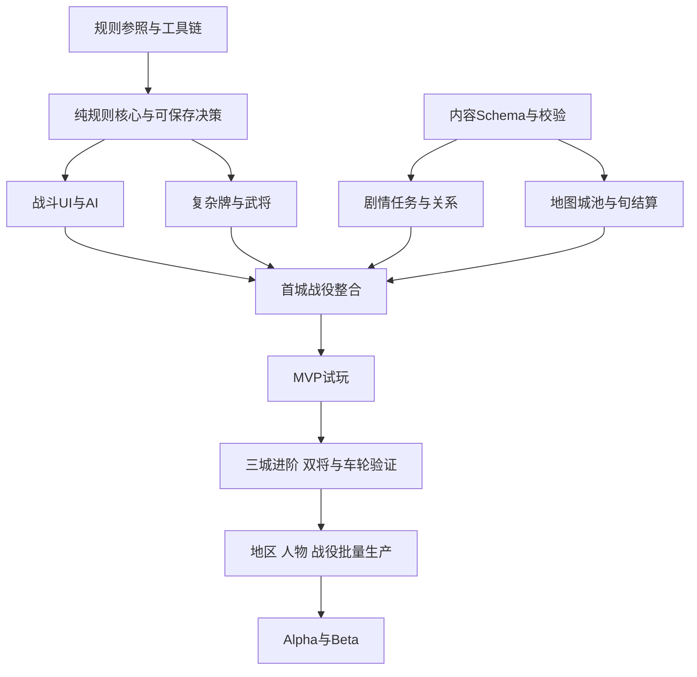

# 三国行纪 开发计划

日期：2026-11-12　状态：按资源假设估算，立项后以实际产能校准

优先交付一个完整的首城试玩，再决定是否投入统一天下的完整版。默认配置为**1名全职主导开发者，使用AI辅助编码与内容草拟，主角与通用角色美术、场景、音乐和集中测试按阶段外包；OL武将立绘按来源目录整理接入**。AI是工具，不折算成独立全职人力。没有团队与预算信息时，按这一配置估算，比默认存在完整工作室更稳妥。

工期按相对周编号计算，不以本文件日期作为自动开工日。W1为实际启动后的第一周。2026-11-12已启动M0/G0工程，SG-007三线大纲已有制作草稿与结构检查，任务的实际状态、验证证据与未完成项见[开发进度](06-开发进度.md)；下文仍为全量计划，不代表全部已经交付。

## 1 资源与进度假设

| 项目 | 计划假设 |
| --- | --- |
| 主导开发 | 每周约40小时投入，其中25小时可形成工程与内容有效产出 |
| 其余时间 | 学习、沟通、评审、排错、试玩与管理；不按40小时满负荷估算 |
| 技能基础 | 熟悉至少一种编程语言，能持续学习Godot和C#；完全零基础需另加学习阶段 |
| 美术 | 战役页面可先占位；战斗原型必须接入OL式桌面、部件视觉与状态反馈，M0先冻结同一PC端界面参照 |
| 音频 | M1先做提示、台词字幕和静音回退，1名测试武将短语音可试接；MVP优先易接入的技能、阵亡片段，长剧情配音后置 |
| 测试 | 规则自动化由开发者维护；MVP起邀请12名目标玩家分批试玩 |
| MVP | 三背景各自从开场到首城的45至90分钟切片；原累计20周目标待按三线任务量重估 |
| 完整版范围 | 三套完整主角故事＋至少100名OL武将；按背景、章节和事件组织叙事生产 |
| 工期状态 | 旧3300小时、132周工作加12周机动的144周情景只覆盖此前单主线范围，已失效；新增原型UI还原也须单列，M0拆分、M1及三线样板实测后重新给出总工时与周期 |
| 团队假设 | 如增加工程与内容人力，按三线章节与共用规则依赖另行排程，不简单按人数除工期 |

如果只能每周投入10至15小时，应按有效产出重新换算；首城短篇可作为独立试玩交付，但三套完整故事和百人武将仍是1.0门槛。完整版不承诺未经实测的固定日期。

## 2 里程碑与退出条件


原W1至W6仅保留工程任务顺序，不能覆盖新增UI采集与还原工作量；M0拆分、M1实测后重排，M2起再按三线切片实测更新，不再沿用旧M4至M6周数。各阶段须完成实现、内容和验收，不能先写一条完整主线，最后为另外两个背景补开场。

| 里程碑 | 核心交付 | 验收门槛 | 未通过处理 |
| --- | --- | --- | --- |
| M0 立项与试验 | OL来源与PC界面快照登记、关键操作截图录像、工具链、最小导出保存；三线故事大纲 | 真机导出可运行，来源可追踪；三线动机、冲突、转折与尾声分别成立 | 调整工具链或故事因果，暂停批产 |
| M1 战斗原型 | P0八种牌效果、2名武将、奋击I阶、双方各1至4单位、基础AI；OL桌面、武将框、手牌技能区与完整出牌响应操作、字幕回退 | 100固定种子与恢复通过；U-001至U-007及U-008无语音回退通过，截图与逐步录像可对照 | 后置高级特效和角色短语音，延长必要工时，不削减核心UI还原或规则 |
| M2 首城MVP | 每线3主线单元＋5个共享支线池，共14个逻辑单元；6基础遭遇、6名OL武将、每线3可招募、三种I阶、首城与两类外交 | 三背景各自从新档走通45至90分钟首城切片，主角目标与人物交集不同；12名试玩者反馈 | 修正主角因果和教学，暂停扩充，重估原20周目标 |
| M3 生产样板 | 累计12名OL武将；三线各一段首城后至中期转折的可玩样板；共用与轻量事件模板；双将、车轮试验 | 主角选择各有可见后果，人物参与由事件需要推导；恢复、4对4、双将与三批接替通过，取得三线内容及各复杂度武将实测工时 | 重写薄弱章节，重排工时，不合并三线或下调百人底线 |
| M4 内容完成 | 三套完整故事；45个独立主线单元＋25个共享支线；6区域24城、至少100名OL武将、30基础遭遇及各线变体；各线独立尾声 | 三线均可进入统一并收束；逐事件因果、路线引用、人物入口、OL完整技能和资产校验通过 | 简化无交集叙事与表现；不足则延长排期 |
| M5 Alpha | 每线20至30小时体验；三背景、单双将、车轮平衡与存档迁移 | 每条故事完整走通，代表阵容和三类结局取向可达，主角成长有持续差异 | 修正因果、体验及阻断问题，禁止新增玩法 |
| M6 Beta | 资源收口、全路线兼容与恢复、发行候选包 | 干净目标机、离线、升级恢复通过，严重缺陷清零，三线及百人门槛达标 | 使用重估后单列的机动储备，必要时延期 |

架构文档中的G0指M0的工程验收关口。M0是业务工程开始的门槛；素材使用范围是公开分发的门槛，不要求内部占位原型等候完整商业许可。公开试玩也需检查素材适用范围。

## 3 工作量重估方式

旧3300小时预算不继续作为新范围的合计。三套主角故事增加章节设计、文本、条件分支、人物交集适配、场景演出、存档状态和全流程回归，不能用取消6条武将关系链简单抵消，也不能直接把旧全部工程工时乘三。

| 工作包 | 新范围的计量依据 |
| --- | --- |
| 规则与工具链 | 一套共用卡牌引擎与来源登记，不按三线重复计算 |
| 百人技能、AI与双将 | 以至少100名不同武将的复杂度、共用机制和交互案例计量，剧情轻量不减技能工作 |
| 三线故事设计 | 各线章节因果、主角关键选择、后果及独立尾声，按实际事件分别估算 |
| 剧情与关卡 | 45个独立主线单元、25个共享支线及各线适配、轻量入口、30个基础遭遇与剧情变体 |
| 剧情状态与工具 | 路线锁定、事件引用、选择后果、共享任务适配、招募路径与可达性报告 |
| OL战斗UI还原 | M0参照与状态表、部件视觉接入、出牌响应状态机、截图录像比对与U系列验证，作为M1必交单列 |
| 客户端与资源 | 战役界面骨架复用，路线场景与文本演出按清单估算；战斗页以OL参照为准 |
| 字幕与角色短语音 | 提示字幕、事件绑定、分组音量和缺失回退先做；技能阵亡片段逐批计量，长剧情配音后置 |
| 招募、领地与成长 | 共用规则与事务一次实现，各线入口、功能事件与技能修习分别集成 |
| 全流程与发行验证 | 三套从新档至统一的主线回归、人物招募状态、三类尾声取向、存档恢复和兼容 |
| 机动储备 | 在内容估算与实测返工率确定后单列，不沿用旧12周数值 |

统一重估公式为“共用工程与规则＋OL战斗UI还原及验证＋字幕和已选短语音＋三条主线独立内容＋共享内容及各线适配＋百人入口补齐＋跨状态集成回归＋返工与机动”。M0先列出完整三线事件表，M2测三种首城切片，M3再测中期样板，分别记录设计、文本、配置、实现、验证及返工。只生成文本或写完目录不能计为交付。

每周仍按25小时有效产出换算工期；主角、通用角色、场景与音频外包方工时及费用另记，不混入主导开发者工时。不以AI草拟速度代替可玩内容产能。武将规则复杂度与事件叙事深度分别计量。

## 4 首城阶段的原工程顺序与三线调整

以下W1至W20保留原工程任务顺序，新增界面工作使W1起均为待重估的工作槽位，不表示三线新增内容仍能在同样周数内完成；M2验收以三种背景切片完成为准。

| 原工作槽位 | 主任务 | 可检查产物 |
| --- | --- | --- |
| W1 | 取得参照规则；登记OL快照与人物范围，跑工具链试验；建立三线主角目标与全程大纲 | 工具链决策、OL来源索引、OL PC界面截图与操作矩阵、Windows包、三线章节因果表 |
| W2 | 建工程、测试、内容校验最小框架、序列化与随机数试验 | 可保存恢复的最小会话；固定随机测试向量 |
| W3 | 角色、座次、牌堆、阶段、基础牌；接入OL桌面、武将框、手牌与操作区 | 杀闪桃通过OL式界面操作，合法目标与错误反馈可对照 |
| W4 | 5种锦囊、支付、响应、处理区与嵌套；技能、目标区域选牌和响应UI | P0八效果与选牌、确认取消、决斗和无懈流程；对照录像 |
| W5 | 2名测试武将、奋击I阶、AI、濒死与死亡、规则日志 | 关羽与曹操测试遭遇、OL式技能反馈、提示与字幕回退；可试接1人短语音，AI能完整出牌响应 |
| W6 | 1至4对1至4串通、4对4、重放、响应点保存、100种子模拟 | 含OL UI还原的M1演示包、规则与界面差异表、U系列证据及工时复盘 |
| W7 | 地图、旬与行动点、对话、条件效果 | 从村落到驿站的探索路径 |
| W8 | 任务状态、条件招募、永久名册、重复扣费与奖励防护 | 一个主角事件及其人物交集的接受、成功、拒绝与失败路径 |
| W9 | 无上限名册、自由编队、三种出身I阶与共用修习战、挑战配置 | 人物页、四位置自由编队、出身固定不互换、人物信息与招募顺序由玩家自主查看和选择 |
| W10 | 补完OL基础牌组、判定、装备和所需基础设施 | OL牌组清单与规则矩阵；若超量优先调整后续表现工时 |
| W11 | 其余4名MVP历史人物与AI适配 | 6名人物在指定技能版本下可运行 |
| W12 | 首城两阶段卡牌守将战、阶段保存、纯卡牌战果事务 | 仅最终阶段卡牌获胜占城，失败立即重试，读档不重复发解锁 |
| W13 | 领地路线与首次占领、世界事件推进、互不侵犯与交换线索 | 首城记录首次成长并开放后续修习线索；无经济字段；条约期限与守城牌局正确 |
| W14 | 三线各3主线单元及5个共享支线池、6基础遭遇与路线变体 | 三种背景分别从开场到首城的内容初版，各45至90分钟，允许占位资产；此工作槽位需重新估时 |
| W15 | 教学与关键页面可读性、战斗提示和日志 | 无需开发者口头讲解的首次体验版本 |
| W16 | 系统集成、所有决策点恢复、8单位与成长边界 | 完整闭环通过，修复主线阻断问题 |
| W17 | 三种出身分别走通MVP、验证自由招募和中立人物查询 | 三种I阶与各组自主阵容可通关，无职业指定搭档 |
| W18 | 新技能边界、出身存档、跨路线拒绝与三组教学修复 | 费用、控制权、受伤与濒死、保存恢复案例通过 |
| W19 | 第一批6人试玩，每种出身2人，集中修复 | 三条路线的配合反馈、复现问题与修改记录 |
| W20 | 第二批6人试玩，每种出身2人，验收与重估 | M2验收记录、三路线差异、后续排期 |

W10和W11是高不确定性工作，M0先给每个技能标复杂度；若预估超过总容量，减少可选表现与支线分支，或诚实延长M2。不能以保留未验证技能同时宣称“OL规则支持完成”作为通过。

### 4.1 MVP人物清单

六名武将分别绑定《三国杀Online》已存在的具体版本、原立绘或皮肤及完整技能。来源目录在M0登记，关卡配置只引用已核验条目。

| 人物 | MVP用途 | 招募结果 | 出场限制 |
| --- | --- | --- | --- |
| 关羽 | 开场援助与可选招募任务 | 条件满足后永久加入 | 故旧关系仅用于叙事，不触发招募后离队 |
| 赵云 | 长期队友、转换牌技能样例 | 可永久招募 | 序章后经章间跳时进入 |
| 张辽 | 阶段替代技能样例与后续招募线索 | MVP仅出场，招募条件留至完整版制作 | 不按历史归属额外否决已满足的招募条件 |
| 华佗 | 医疗与濒死交互、长期队友 | 可永久招募 | 以医者立场和救人任务为条件 |
| 曹操 | 势力接触与P0规则测试角色 | MVP仅出场，招募条件留至完整版制作 | 通过剧情或测试遭遇验证其技能 |
| 吕布 | 首城对手或援军相关人物 | MVP仅出场，招募条件留至完整版制作 | 在章间跳时后出场；非184年开场 |

张角、荀彧等蓝图中的人物是完整战役候选，不包含在MVP的6名预算中。首城可以是架空地方据点，不声称吕布在真实历史中一定控制此地。若测试发现首城吕布过强，调整敌方人数、我方可选援助与座次，不修改其被冻结技能本身。

## 5 依赖与实施顺序



M3完成三线中期故事样板、双方各4单位、三出身固定技能路线、双将与三批车轮原型；M4在每条故事约1/2与3/4处分别制作本线协同与接战事件，映射到共用永久功能标记及候选池；M5验证三种出身、单双将、普通战与车轮战的组合，以及全部主副配对和重点联动。双将模式使用明置主副、公开阵营和本项目歼灭胜负规则。

单人按依赖串行推进；工具或AI可辅助整理案例与生成候选数据，但每个规则裁定、剧情文本和正式资产仍由开发者审查。若后来组建团队，再把相互独立的内容与客户端任务分配给不同成员，不提前制造并行管理成本。

## 6 第一批可直接创建的任务

| ID | 任务 | 产物与验收 | 依赖 | 估算 |
| --- | --- | --- | --- | --- |
| SG-001 | OL规则与角色登记 | 基础规则与MVP6武将均有OL具体版本、原立绘、完整技能和裁定来源 | 无 | 8小时 |
| SG-002 | 工具链兼容试验 | macOS开发、Windows导出与独立运行，记录SDK及引擎版本 | 无 | 12小时 |
| SG-003 | 最小工程和测试入口 | 两个核心空库、一个测试、一个Godot展示命令 | SG-002 | 8小时 |
| SG-004 | 受控随机流与快照 | 固定测试向量、保存恢复后抽样序列一致 | SG-003 | 8小时 |
| SG-005 | 内容ID与最小校验器 | 对重复ID和缺失牌引用给出可定位错误 | SG-001、003 | 8小时 |
| SG-006 | G0验收与工具链锁定 | 汇总5项证据、冻结范围与后续案例列表 | SG-001至005 | 6小时 |
| SG-007 | 三套主角故事全程大纲 | 三背景各有开场困境、首城因由、中期转折、统一尾声和章节因果表；不设重点武将人数配额 | 无 | 按章节拆分后估算 |
| SG-008 | 三背景首城事件与交集表 | 每线3主线单元、5共享支线适配、参与人物及轻量入口、招募替代路径和三线样板任务单 | SG-007 | 按事件拆分后估算 |
| SG-009 | OL PC战斗界面参照冻结 | 同一版本截图、逐步操作录像、布局与按钮状态矩阵、快捷操作核验及项目差异表 | 无 | 按采集状态拆分后估算 |
| SG-010 | OL式原型客户端与U系列验证 | 对应P0八效果、两武将与奋击的桌面及交互；提示字幕、无语音回退和对照证据 | SG-003、005、009及对应规则能力 | 按组件和操作场景拆分后估算 |

SG-001至006保留原工程子集的50小时估算；三线大纲、首城事件及新增UI参照与还原分别计量，不以50小时作为M0总容量，也不默认仍在两周内完成。后续每次细化未来两周的工程与内容任务，依据产物和实测更新估算。

## 7 按三线章节推进内容生产

M3先完成累计12名OL武将的生产样板，覆盖低、中、高技能复杂度与新增共用机制；三条故事各制作一段首城之后、中期转折之前的可玩内容，验证背景差异能持续到开场以后。同一武将在不同路线的交集、无深交者轻量入口、提前招募与未招募的事件承接同时采样。按样板实测重估剩余工作，不按固定武将名单分配长链配额。

M4先使用以下累计内容批次控制进度，周范围在M3后确定；三线按阶段推进，避免只完成一条而把其余故事留到最后：

| 批次 | 累计地区与城池 | 累计内容 | 验收重点 |
| --- | --- | --- | --- |
| 第1批 | 3区域、8城 | 30名OL武将；各线6主线单元＋12共享支线，共30逻辑单元；12基础遭遇 | 三线各自承接首城、形成不同的扩张动机；人物入口可玩 |
| 第2批 | 4区域、14城 | 55名OL武将；各线10主线单元＋18共享支线，共48逻辑单元；18基础遭遇 | 三线中期转折、不同人物交集与协同解锁事件成立 |
| 第3批 | 5区域、20城 | 80名OL武将；各线13主线单元＋22共享支线，共61逻辑单元；24基础遭遇 | 三线从各自矛盾走向天下之争、接战解锁及前期选择回响 |
| 第4批 | 6区域、24城 | 至少100名OL武将；各线15主线单元＋25共享支线，共70逻辑单元；30基础遭遇 | 三线独立统一尾声、三类结局取向、全量武将入口收口 |

上述人物数为跨三线共用内容池，不能把同一武将在三线出现算作三名。人物叙事深浅按“路线—事件—参与者”表决定，轻量事件数量依覆盖缺口核算，不固定为94名；共用支线与基础战斗模板不重复计数。每批都要求可连续游玩、任务引用和一次性奖励通过，不用待办目录代替完成内容。

## 8 验收清单

### 8.1 M1 战斗原型

- 指定8种效果、2名武将及奋击I阶可完整结算；明确标为P0子集。
- OL PC端同一界面快照、操作矩阵与差异表已冻结；原型桌面、武将框、手牌技能、确认取消、响应及结算反馈通过U-001至U-007和U-008无语音回退，不以调试面板或静态皮肤代替。
- 角色台词字幕和必要提示完整；实际技能、阵亡短语音按难度选做，启用后补验播放、静音、并发和读档去重。
- 100个固定种子的批量对局无牌丢失、非法行动和未解释死锁。
- 玩家响应点保存后恢复，下一结果与未中断版本一致。
- 规则日志可追溯一次杀、闪、伤害、濒死、救援和死亡。

### 8.2 M2 首城MVP

- 三线各3个独立主线单元加5个共享支线池，共14个逻辑单元；6名OL武将、每线3名可招募及6个基础遭遇到位。共用华佗招募与所属出身入门修习的战斗结果，各线分别解释接触原因和后续承接，不重复发战果。
- 三种背景各有开场动机、主动选择与取得首城的因由，不只是同一任务替换称呼和技能。
- 至少两种阵容通关；永久名册超过12人仍可自由换人，主角可不占上场位，不设置城池岗位或驻军编队锁定。
- 失败可立即调整阵容重试；第二场攻城读档保留已过阶段，不重复发首次占领奖励。
- 卡牌攻守城、永久招募、条约、主角进阶、自由换人与世界推进均有中断恢复案例。
- OL牌组、6名武将完整技能及三种主角I阶技能矩阵通过；12名试玩者按出身分组记录，目标按蓝图。
- 至少演示4对4、4对2和1对4；两边各超4与空队伍被拒绝，剧情援助不能超位。
- MVP所有战斗只由卡牌全灭判胜负；完整版车轮必须先检查合法替补，城池变化只接收整场终局胜利ID，地图和外交无直接占城路径。
- 含占位资产的内部包标明内部用途，公开试玩前资产替换或许可确认完成。

### 8.3 M5 Alpha与M6 Beta

Alpha逐条验证三套故事从新档到统一尾声，并验证各线约1/2和3/4处对应事件的双将、车轮解锁，覆盖少量招募、剧情重复、路线状态恢复及单将、双将、车轮组合。重点验证玩家自主选择阵容及后期依靠武将弥补主角短板；对关键分支另做状态注入回归。20至30小时是完整体验目标，不以拖长战斗动画凑时长。

1.0内容验收必须包含至少100名不同OL武将的实际清单、完整技能案例与AI合法操作、三套独立主角故事的因果、转折、尾声及按事件配置的人物交集与轻量入口；可招募条目逐人从条件满足走到永久加入，并验证重复提交和保存恢复。主线不要求全收集，全部人物入口用状态注入与代表正常流程交叉验证。

Beta要求阻断、坏档、主线不可达、崩溃类缺陷为0；高严重度规则错误为0；其余已知问题有明确影响记录。执行至少10000场快速模拟、100条固定重放以及20组迁移与中断恢复样本，这些规模可随运行成本调整，但每一关键规则点的案例不能删。

自动模拟的步数保护触发视为待调查失败。人工读档与最终发行包验证不可由模拟数量代替。

## 9 风险与应对

| 风险 | 尽早出现的信号 | 应对 |
| --- | --- | --- |
| 规则版本不清 | 同一技能有多个互相矛盾的解释 | M0冻结规则来源，争议进裁定表，不在代码里临时猜 |
| SDK或导出不兼容 | 编辑器能跑但独立Windows包失败 | G0真机测试；先解决工具链再造业务 |
| 复杂响应拖垮工期 | 每加一个技能都重写结算流程 | 显式决策帧、案例先行、控制复杂技能入包 |
| AI不够聪明 | 长时间空转或无意义出牌 | 先保证合法和稳定，再改评分；不得读取隐藏信息补难度 |
| 领地成长缺乏吸引力 | 占城只是换地图颜色 | 每座城明确解锁路线、招募线索、剧情或技能修习战 |
| 养成破坏原规则 | 高等级角色无视牌效碾压 | 约束横向养成，保留基础伤害与体力尺度 |
| 车轮状态或信息错误 | 换批重置敌方、重复上场、提前发奖励或AI窥探玩家选择 | 独立牌局与车轮分开，保存完整接替状态、逐事务去重、部署权限与可见性隔离 |
| 双将交互爆炸 | 每个组合出现重复触发或新增裁定 | 技能来源与次数去重，M3提前验证，M5组合矩阵与定向回归 |
| 三线退化为换开场 | 中期任务、选择和尾声完全相同，只有背景称呼不同 | 各线独立因果与事件验收，共用系统和素材；缺少完整故事则不通过1.0 |
| 剧情组合爆炸 | 多名已招募武将共同出现时文本分支过多 | 先定主角事件再安排交集；无深交者轻量入口，人物状态用有限变体，已招募资格保留 |
| 内容产能不足 | 连续两批未达到至少80%计划 | 按已定义裁剪包缩内容，保留闭环与质量 |
| 后期无聊 | 后十城重复相同敌方阵容 | 用人数、技能组合、座次、固定出身进阶、双将与车轮临场克制变化；不引入扫荡或经济胜负 |
| 百人技能接入超预算 | 文本已完成但技能依赖、AI或双将案例积压 | M3实测不同复杂度，按共用机制分批接入；简化叙事或延长排期，完整技能和100人底线不变 |
| 外包返工 | 风格、字体、卡面尺寸不一致 | 先验收主角与通用角色样板、1张场景及2套OL武将资源接入，再批量生产与集成 |
| 发行素材范围不清 | 武将、UI或音频素材未登记来源与适用范围 | 武将、UI部件及音频逐项登记来源、版本与使用范围，构建包按登记范围校验 |
| 单人负荷过大 | 长期靠额外加班才能维持周产能 | 维持25小时有效产出基线，砍内容并保留储备 |

## 10 成本与采购方式

先确定可承受的总投入，再决定资产档次。暂不凭空给出市场报价，采用以下可填预算模型：

```text
总现金预算 =
    开发期生活与固定支出
    + 主角、通用角色和场景采购或外包
    + OL武将立绘整理、版本核验与使用范围确认
    + 音乐音效与字体许可
    + 测试设备与集中测试
    + 发行账号与必要签名服务
    + 已有内容使用所需授权费用
    + 15%至25%现金机动
```

MVP只支付足以验证风格和体验的样板。完整版资产批量采购在M2体验通过、M3产能实测之后进行。现金储备与重估后单列的工期储备是不同维度，不互相抵消。工具和引擎的实际费用以采购时官方条款为准。

## 11 日常推进与验收

每周保留一份能运行的构建、一张当前缺陷清单、一次固定样本回归和一份工时记录。每两周演示实际体验，确认当前范围、完成项和待办项；仅“代码写完”不能关闭任务。

每个任务记录：所属系统、验收、内容依赖、是否影响存档、估算、实际时间与复现证据。工程、内容、来源目录和文档保持一致，提交信息使用中文。M2、M3、M4结束作范围与余量重估，不因原排期存在就继续扩大投入。

第一步从SG-001、SG-002及SG-009开始，登记规则、工具链和OL界面参照。整个项目当前的下一交付应是**可运行、可恢复且还原OL战斗UI与交互的原型**，随后完成首城闭环，再扩充统一天下战役。
